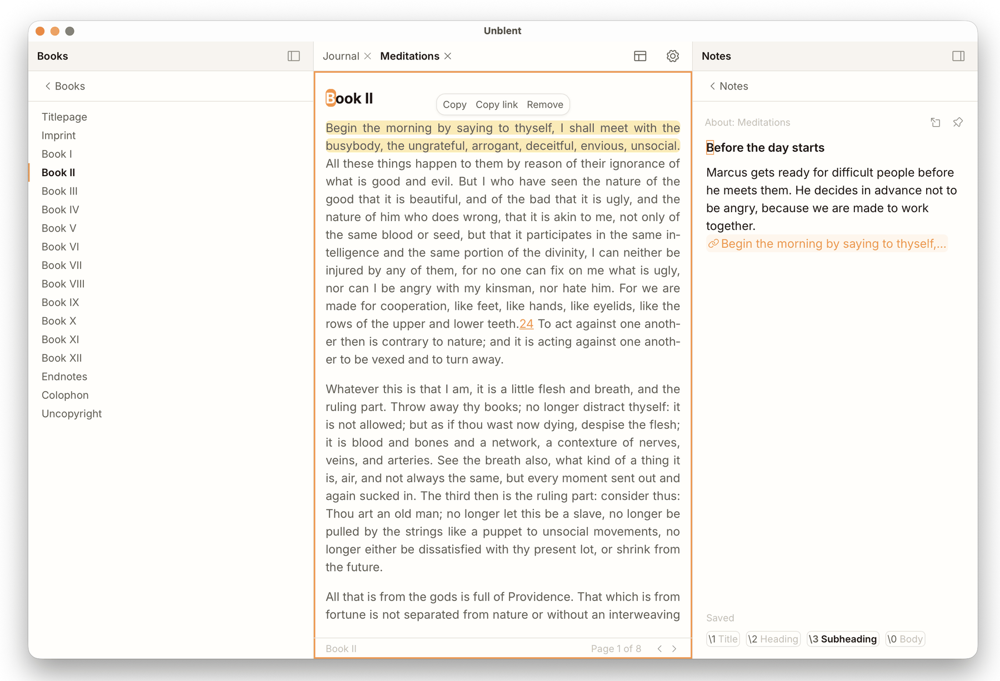
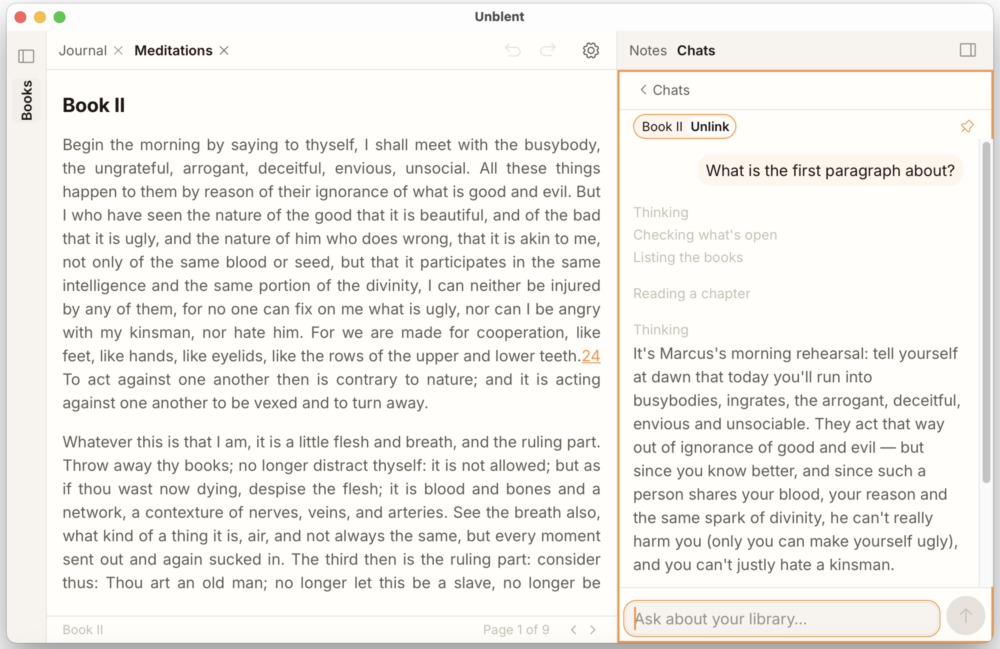
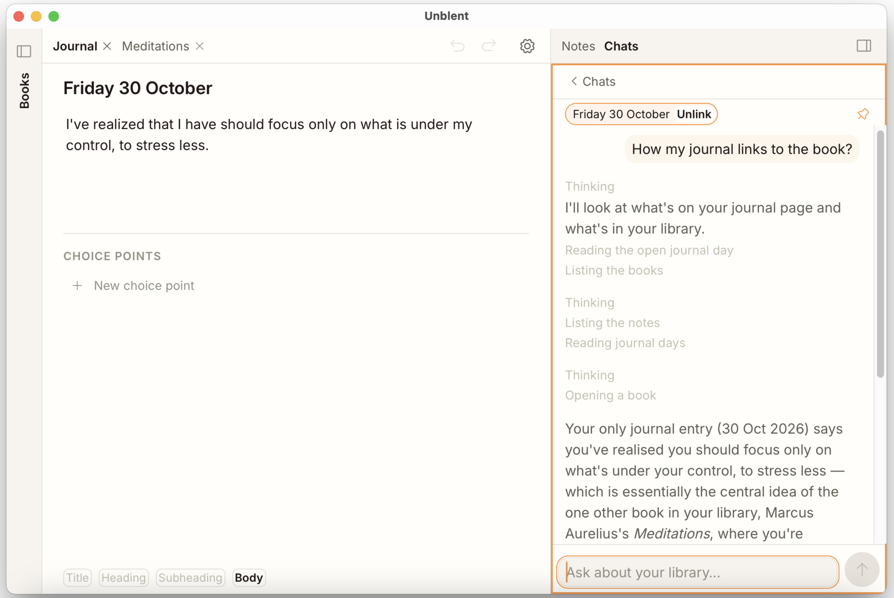
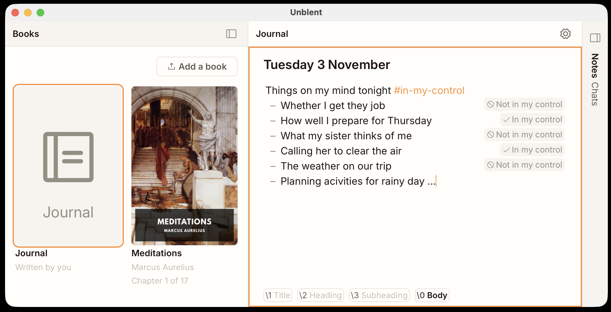
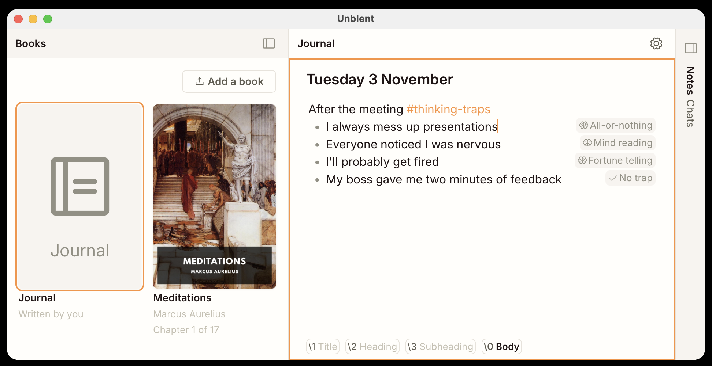
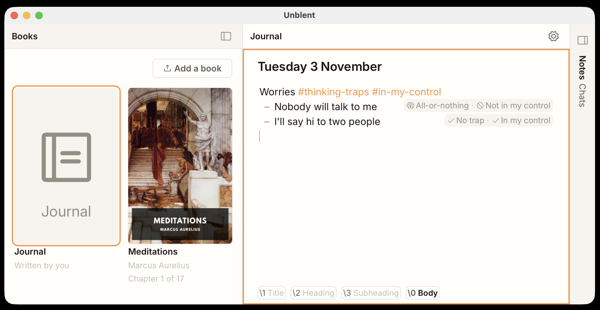
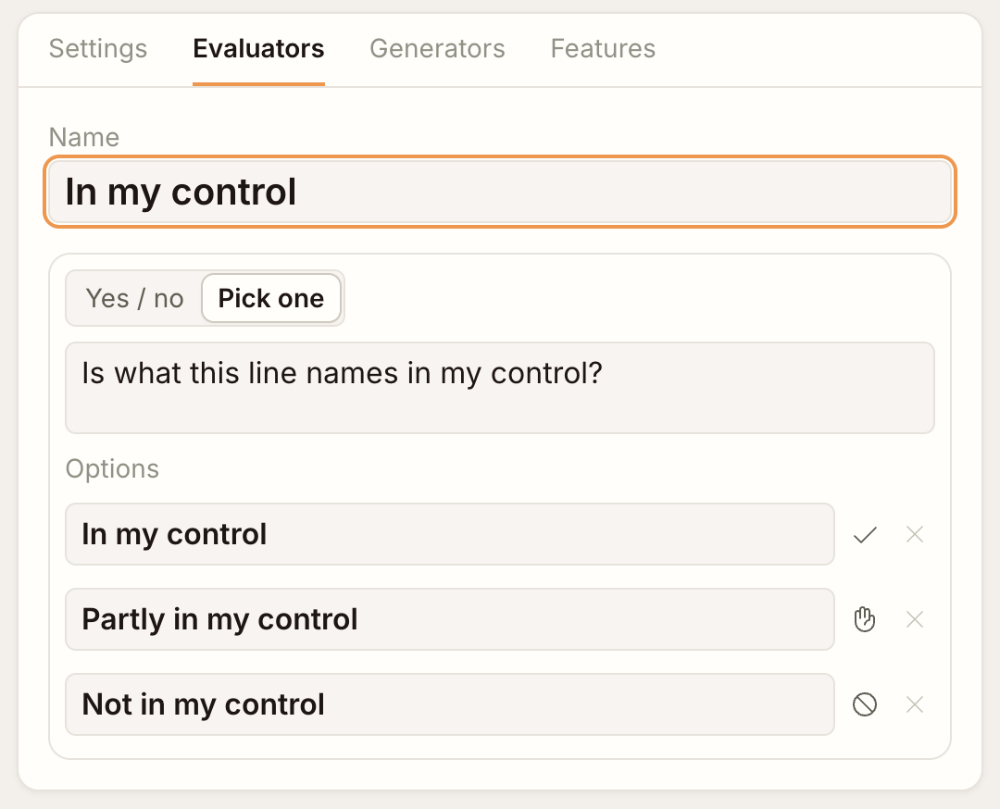
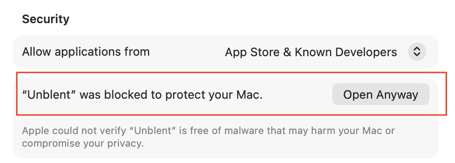

# Unblent

A free ePub reader for the Mac. Write notes beside the page, ask your books questions,
and let small checks read every line you write in your journal.

Free and open source (MIT). It works offline: your books, notes and journal stay on
your Mac.

```sh
brew install --cask maciekkreft/unblent/unblent
```

Before the first open, read
[Required: read before you open the app](#required-read-before-you-open-the-app).

## Notes beside the book

<p align="center"></p>

Mark a passage, copy a link to it, and paste the link into a note. The note stays open
on the right while you read on. Clicking the link opens the book at that passage. Each
book keeps its own notes.

## Chat with your books

<p align="center"></p>

Ask about the page you are reading. Before it answers, the chat looks things up in your
own library: the chapter, your notes and highlights, your journal days. Every look-up
is shown above the answer, such as *Reading a chapter*, and you can open it to see what
was read.

<p align="center"></p>

It also links what you write to what you read. Here it reads a journal day and finds
the same idea in *Meditations*.

The answers come from [Ollama](https://ollama.com) on your own Mac: free, offline, and
no key needed. See [Chats with Ollama](#chats-with-ollama).

## Check every line you write

<p align="center"></p>

Put a hashtag on a line, such as `#in-my-control`. Every line under it, up to the next
blank line, gets a mark at its end as soon as you finish typing it.

<p align="center"></p>

A different hashtag asks a different question. `#thinking-traps` names the thinking
trap in each line, or says there is none.

<p align="center"></p>

Use two hashtags and each line gets both answers.

<p align="center"></p>

The checks are called evaluators, and you write your own. Click the gear, open
**Evaluators**, and press **New evaluator**. An evaluator is a name and a question,
answered yes or no or by picking one of your options, each with its own icon. Its name
becomes its hashtag.

The marks come from Kev, a small decision model that runs in
[Ollama](https://ollama.com) on your Mac. It answers in a fraction of a second, free
and offline. See [Checks with Kev](#checks-with-kev).

## Also in Unblent

- **A daily journal.** One page per day. Today's page can be edited until 2 a.m.; past
  days are read only.
- **Vim keys.** With Vim keys on, reading, highlighting, moving between panels and
  writing all work from the keyboard. See [Keyboard](#keyboard).

## Install

With [Homebrew](https://brew.sh):

```sh
brew install --cask maciekkreft/unblent/unblent
```

Or download `Unblent.dmg` from the
[latest release](https://github.com/maciekkreft/unblent/releases/latest), open it,
and drag Unblent to Applications.

## Required: read before you open the app

- **The first open is blocked.** The app is not signed with a paid Apple developer
  account, so macOS stops it the first time. Open System Settings → Privacy &
  Security, scroll to Security, and click **Open Anyway**. You only do this once.

  <picture>
    <source media="(prefers-color-scheme: dark)" srcset="mac/readme/open-anyway-dark.png">
    
  </picture>

- **Apple Silicon only, macOS 12 or later.**
- **Only DRM-free ePub files.** Books bought from stores that lock their files will
  not open. On first start, *Meditations* by Marcus Aurelius, from
  [Standard Ebooks](https://standardebooks.org), is already on the shelf.
- **One person per Mac.** There is no account and no sync between devices.
- **Your books, notes and journal stay on your Mac**, in
  `~/Library/Application Support/Unblent`. The only thing the app sends over the
  network is a check on GitHub for a new version, unless you choose Anthropic for
  chats (see [PRIVACY.md](PRIVACY.md)).
- **The app updates itself.** When a new version is ready it asks you to
  *Restart to update* or *Later*. Because of this, `brew upgrade` does not track
  Unblent's versions.
- **`brew uninstall --zap unblent` deletes your books, notes and journal.** A plain
  `brew uninstall` leaves them in place.
- **Unblent uses local port 47321.** If another program uses it, Unblent cannot
  start.

## Chats with Ollama

1. Install Ollama from [ollama.com](https://ollama.com) and open it.
2. In Terminal, run `ollama pull gemma4:e4b-mlx`.
3. In Unblent, open the Chats panel and ask a question.

Settings › Your account shows whether Ollama is running and which model answers. Any
model you download with `ollama pull` appears there. If you prefer, choose Anthropic
and enter your own API key instead.

## Checks with Kev

1. Install Ollama 0.40.4 or later from [ollama.com](https://ollama.com) and open it.
2. In Terminal, run `ollama pull kev:0.8b-mlx-bf16`.
3. In Unblent, write a line with a hashtag, such as `#in-my-control`, and a list
   under it.

Settings › Your account › Evaluating shows whether Ollama is running and which model
makes the checks, Kev unless you choose another. If you prefer, choose Jev and enter
your own Jev key instead.

## Keyboard

These keys work once **Vim keys** is on: click the gear at the top right of the
middle panel, then tick Vim keys. "Show the keys" under the switch lists them too.

<details>
<summary>All keys</summary>

**Panels and tabs**

| What | Keys |
|---|---|
| Fold or unfold the left or right panel | Ctrl+Shift+H, Ctrl+Shift+L |
| Move to the panel on the left or right, or back to the middle | Ctrl+H, Ctrl+L |
| Next or previous tab of the panel you are in (books, the journal and notes in the middle panel) | Ctrl+. and Ctrl+, |

**Reading**

| What | Keys |
|---|---|
| Move the cursor by word, sentence or paragraph | w, b; ( and ); { and } |
| Move the cursor by letter or line, or to the start or end of the line | h, l; j, k; 0, $ |
| Next page | Space, Ctrl+D, Ctrl+F |
| Previous page | Ctrl+U, Ctrl+B |
| First or last page of the chapter | gg, G |
| Make a highlight | v, move the cursor to make it longer, then Return (Escape drops it) |
| Copy a link to a highlight | y with the cursor inside the highlight |

**Writing a note or a journal day**

| What | Keys |
|---|---|
| Paste the copied link | p |
| Follow a link | Return with the cursor on the link |
| Move down or up one screen line inside a long paragraph | gj, gk |
| Make the line a title, heading, subheading or body text | \1, \2, \3, \0 |
| Stop typing and go back to the list | Escape, then Escape again |

**Lists (books, contents, notes)**

| What | Keys |
|---|---|
| Next or previous row; first or last row | j, k; gg, G |
| Open the row | Return |
| Delete a row, and bring it back | dd, then u |
| Make a new note below or above the current row | o, O |

</details>

## Building from source

On a Mac with Apple Silicon, run `bash mac/build-local.sh`. It installs what is
missing with Homebrew, builds the app, and prints where `Unblent.dmg` is.
[mac/RELEASING.md](mac/RELEASING.md) explains how releases are made.

See also [CONTRIBUTING.md](CONTRIBUTING.md), [CHANGELOG.md](CHANGELOG.md) and [PRIVACY.md](PRIVACY.md).

## How it is built

Unblent is built from many small, separate parts. Each part does one thing and is
tested on its own. Parts never call each other directly: they send messages through
one shared channel. The Mac app is a window around a small local server that keeps
your data in SQLite files. [architecture.md](architecture.md) describes the design
and its rules.

## License

MIT, see [LICENSE](LICENSE). Bundled libraries keep their own licenses, listed in
`vendor/vendor.json`.
