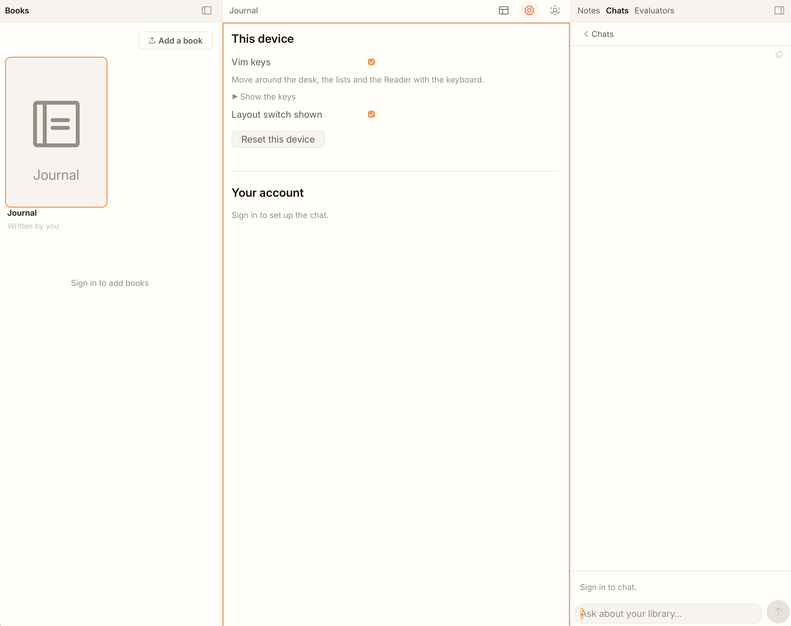

# Unblent

A reading and writing workspace: books with highlights and notes, a daily
journal, chats with a language model about your own library, and evaluators
that answer yes / no questions about a text. It runs at
[unblent.com](https://unblent.com).



## How it is built

The application is built like Niklas Luhmann's slip-box. Each component is
one small, finished piece that does one thing and is tested on its own.
Components never call each other: they send events, commands and queries
through one shared bus. A page is an HTML file that lists which components
to load, and nothing else.

- Local-first: changes are saved in the browser at once and sent to the
  server afterwards, so the app works offline and continues on another device.
- No build step: libraries are vendored and loaded through an import map.
- Browser: Lit, XState, CodeMirror 6, Dexie. Server: FastAPI and one SQLite
  file per user per component, backed up continuously with Litestream.
- Sign-in with passkeys.

[architecture.md](architecture.md) is the full description and the rules.

## Running it

```sh
python3 -m venv .venv && .venv/bin/pip install -r requirements.txt
# .env needs SESSION_SECRET, RP_ID and MAX_USERS
python3 checks/check.py --help   # what to run when
python3 checks/show.py --help    # list components, contracts and pages
```

## Licence

MIT, see [LICENSE](LICENSE). Vendored libraries keep their own licences,
listed in `vendor/vendor.json`.
