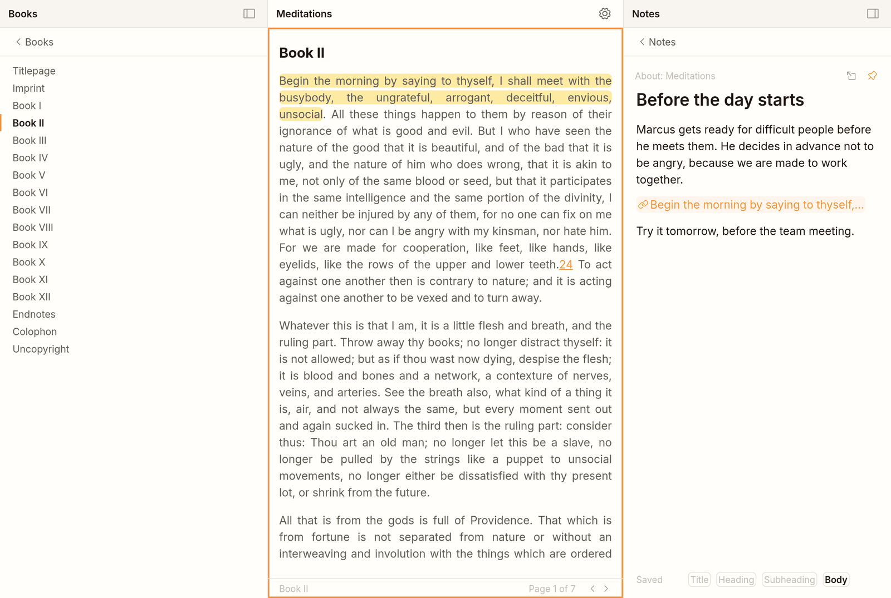
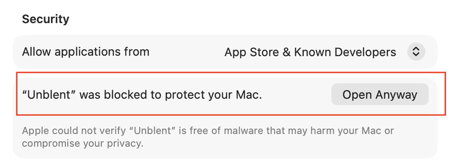

# Unblent

A free ePub reader for the Mac, with notes, highlights and a journal.

<picture>
  <source media="(prefers-color-scheme: dark)" srcset="mac/readme/unblent-dark.png">
  
</picture>

## What Unblent is

Unblent is an ePub reader for macOS. The app is a Tauri window around a small local
Python server; your books, notes and journal are stored as files on your Mac.

- **Notes per book.** Each book has its own notes, shown beside the page you are
  reading.
- **A daily journal.** One page per day. Only today's page can be edited (yesterday's
  stays open until 1 a.m.); past days are read-only.
- **Highlights with links.** You can mark a passage and paste a link to it into a
  note or a journal day. The link opens the book at that passage.
- **Vim-style keys.** With Vim keys turned on, reading, moving between panels,
  highlighting and writing all work from the keyboard.

## Keyboard

These keys work once **Vim keys** is on: click the gear at the top right of the
middle panel, then tick Vim keys. "Show the keys" under the switch lists them too.

**Panels and tabs**

| What | Keys |
|---|---|
| Fold or unfold the left or right panel | Ctrl+Shift+H, Ctrl+Shift+L |
| Move to the panel on the left or right, or back to the middle | Ctrl+H, Ctrl+L |
| Next or previous tab of the panel you are in (books, the journal and notes in the middle panel) | Ctrl+. and Ctrl+, |

**Reading**

| What | Keys |
|---|---|
| Move the cursor by word, sentence or paragraph | w, b; ( and ); { and } |
| Move the cursor by letter or line, or to the start or end of the line | h, l; j, k; 0, $ |
| Next page | Space, Ctrl+D, Ctrl+F |
| Previous page | Ctrl+U, Ctrl+B |
| First or last page of the chapter | gg, G |
| Make a highlight | v, move the cursor to make it longer, then Return (Escape drops it) |
| Copy a link to a highlight | y with the cursor inside the highlight |

**Writing a note or a journal day**

| What | Keys |
|---|---|
| Paste the copied link | p |
| Follow a link | Return with the cursor on the link |
| Move down or up one screen line inside a long paragraph | gj, gk |
| Make the line a title, heading, subheading or body text | \1, \2, \3, \0 |
| Stop typing and go back to the list | Escape, then Escape again |

**Lists (books, contents, notes)**

| What | Keys |
|---|---|
| Next or previous row; first or last row | j, k; gg, G |
| Open the row | Return |
| Delete a row, and bring it back | dd, then u |
| Make a new note below or above the current row | o, O |

## Coming next

These are not built yet:

- Short summaries of past journal days.
- Chats that can access your books, notes and journal, and help you understand
  what you read.
- Exercises from psychology books placed inside a journal day, so you practise a
  technique and do not only write about it.

## Install

With [Homebrew](https://brew.sh):

```sh
brew install --cask maciekkreft/unblent/unblent
```

Or download `Unblent.dmg` from the
[latest release](https://github.com/maciekkreft/unblent/releases/latest), open it,
and drag Unblent to Applications.

Before you open Unblent, read the next section,
[Required: read before you open the app](#required-read-before-you-open-the-app).
Without it, the app will not open.

## Required: read before you open the app

- **The first open is blocked.** The app is not signed with a paid Apple developer
  account, so macOS stops it the first time. Open System Settings → Privacy &
  Security, scroll to Security, and click **Open Anyway**. You only do this once.

  <picture>
    <source media="(prefers-color-scheme: dark)" srcset="mac/readme/open-anyway-dark.png">
    
  </picture>

- **Apple Silicon only, macOS 12 or later.**
- **Only DRM-free ePub files.** Books bought from stores that lock their files will
  not open. On first start, *Meditations* by Marcus Aurelius, from
  [Standard Ebooks](https://standardebooks.org), is already on the shelf.
- **One person per Mac.** There is no account and no sync between devices.
- **Your books, notes and journal stay on your Mac**, in
  `~/Library/Application Support/Unblent`. The only thing the app sends over the
  network is a check on GitHub for a new version.
- **The app updates itself.** When a new version is ready it asks you to
  *Restart to update* or *Later*. Because of this, `brew upgrade` does not track
  Unblent's versions.
- **`brew uninstall --zap unblent` deletes your books, notes and journal.** A plain
  `brew uninstall` leaves them in place.
- **Unblent uses local port 47321.** If another program uses it, Unblent cannot
  start.

## Building from source

On a Mac with Apple Silicon, run `bash mac/build-local.sh`. It installs what is
missing with Homebrew, builds the app, and prints where `Unblent.dmg` is.
[mac/RELEASING.md](mac/RELEASING.md) explains how releases are made.

## How it is built

Unblent is built from many small, separate parts. Each part does one thing and is
tested on its own. Parts never call each other directly: they send messages through
one shared channel. The Mac app is a window around a small local server that holds
your data in SQLite files. [architecture.md](architecture.md) describes the design
and its rules.

## Licence

MIT, see [LICENSE](LICENSE). Bundled libraries keep their own licences, listed in
`vendor/vendor.json`.
