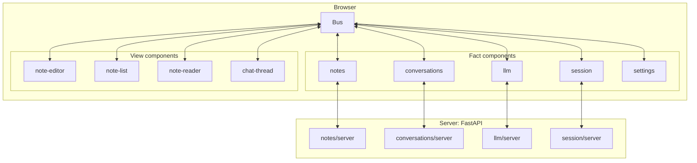
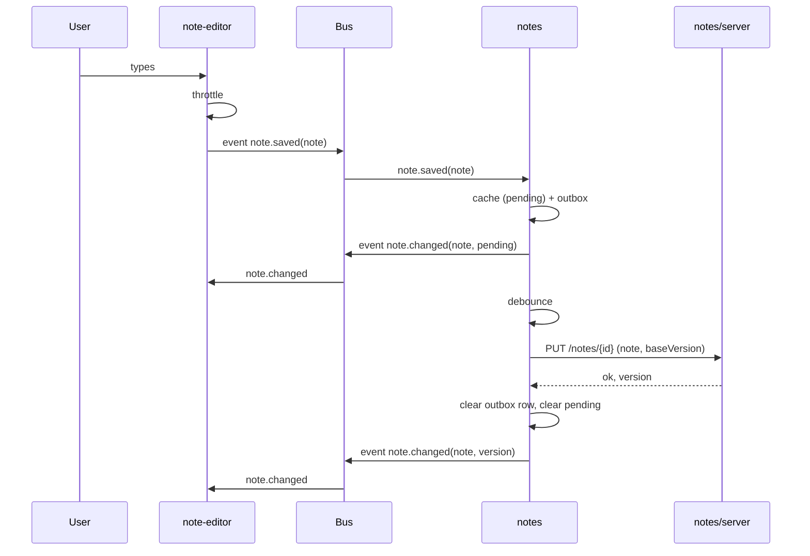
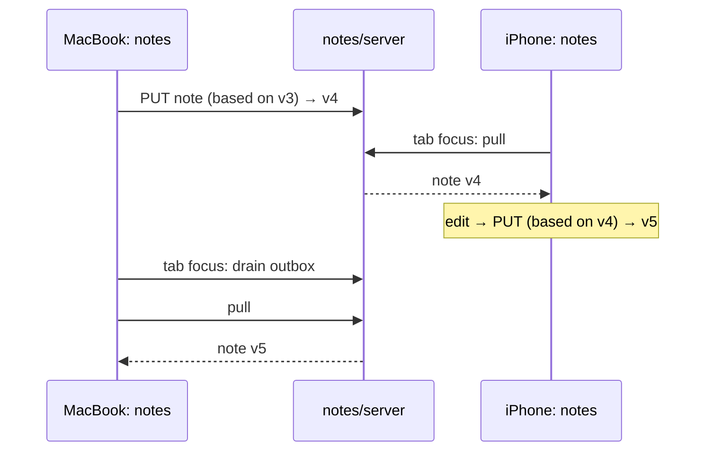
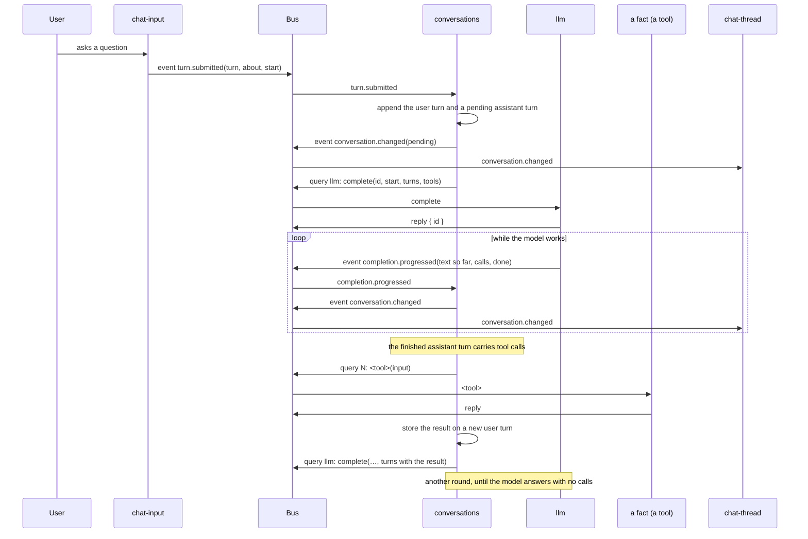

# Slip-box architecture

How this application is built, for people joining the project. It covers the idea, the building blocks, how they exchange information, the contracts between them, the pages that compose them, the libraries we lean on, and how the rules are enforced. It contains no implementation.

---

## 1. The idea

Niklas Luhmann wrote dozens of books without ever sitting down to write a book. He wrote thousands of small, finished notes, each on one idea, each pointing by name to related notes, and kept them in a slip-box. A book was a path through the box. He could work on whatever interested him that day, change his mind after any note, and the collection still grew into something coherent.

We build software the same way. A **component** is a note: small, complete, tested, useful on its own. Components never touch each other. They announce facts, give instructions, and ask questions through one shared piece of infrastructure, the **bus**, which is the slip-box. An **app** is a path through the box: a page that lists which components to load and nothing else.

The property we optimise for: anyone, including a coding agent, can add, rewrite, or delete a component without opening any other component.

---

## 2. The mapping

| Luhmann | Here |
|---|---|
| A note: one idea, finished, self-contained | A component: one concept, or one way of looking at it |
| The slip-box | The bus |
| A pointer ("see 21/3d7") | Subscribing to a named event, or addressing a named component |
| The index card at the front of a stem | A component's manifest |
| A stem: a note and its follow-ups | A stem: a fact component and its views |
| A book | An app page that declares which components to compose |
| Working on whatever is interesting today | Adding a component nobody planned for |

Where the analogy strains: a book only has to read well, an app has to run. So pointers between components are stricter than Luhmann's. They are contracts (section 7), and changing a contract is the one thing that can break a neighbour.

---

## 3. Building blocks



Every line between a component and anything else goes through the bus. The only exception is a fact component talking to *its own* server module, which is the same component on the other side of the network.

A view may load an image by a URL a fact's reply or event handed it. The fact's server module serves it, and the browser's HTTP cache is the only copy.

### 3.1 Two kinds of component

**A fact component owns a concept.** The notes, the conversations, the settings, the current session, access to the language model. It is headless. It is the single place the fact lives. It emits an event whenever the fact changes, and it answers queries about the fact.

Where it stores the fact is its own business, and there are three shapes:

| Shape | Storage | Offline | Example |
|---|---|---|---|
| **Local-only** | Browser only: localStorage, IndexedDB, memory | Always works; follows the device | `settings` |
| **Replicated** | Browser cache + server, kept in sync (section 5) | Works; syncs later | `notes` |
| **Remote-only** | The fact can only be produced by the server | Fails honestly, with an error reply and, where other views need to know, an `unavailable` event | `llm` |

`python3 checks/show.py components` lists every fact with its shape.

A fact component that needs the server brings its own server module with it, in the same directory (section 11.1). `llm`'s server module holds the account's API key, encrypted at rest and never sent back to the browser (7.7).

A fact may be **derived**: it stores nothing and combines what other facts announce into one answer several components need. `subject` is such a fact; its description (`show.py components subject`) says how it decides.

`flags` owns which features are off for everyone, the admin included. It is remote-only, with one shared file `data/flags.db`; it keeps the last answer it received in localStorage, so a reload or an offline start hides the same features, and with no answer yet it hides every feature that has a flag. Hiding is not a lock: the server modules of a hidden feature still answer.

**A view component owns a way of looking at or acting on a concept.** Editing, listing, reading, chatting. It owns only its own UI state: cursor position, scroll, which tab is open, the draft in the input box. It points at one or more fact components, queries them, listens to their events, and emits events about what the user did. It never holds a copy of a fact it would be sad to lose. UI state worth keeping across a reload — which note is pinned, say — a view may keep in localStorage under a key beginning with its role or name; it follows the browser, never the account, and losing it loses nothing.

### 3.2 Inside a component

Every component, of either kind, has an **actor**: its brain, a mailbox processed one message at a time, where all decisions are made. View components add a **view**, the visible part, which renders the actor's state and forwards user gestures to the actor as commands. Fact components add a **store**, their private persistence, and possibly a **server module**.

Every component also has a **browser entry**, the one file a page loads: `view.js` for a view, `fact.js` for a fact. `fact.js` creates the actor with its inputs and mounts it on the bus; `machine.js` itself starts nothing, so it can be imported anywhere.

A component's **manifest** (section 7.3) is not a separate file: it is read from the actor's definition.

### 3.3 The bus

The one shared piece of infrastructure, built once. It carries events, commands, and queries (section 4), routes each to the right mailboxes, validates every event, every query's payload and reply, and every command's payload against the contract registry, refuses emits, asks and sends a component has not declared, and knows nothing about what any event means. It keeps nothing: there is no event log. The one thing it holds is transient routing state, not retention: an event an asker's open query declares as superseding its answer (4.2), kept only until that query's reply lands. Facts persist in fact components; the bus is only how the news travels.

The bus has one tap: a listener called synchronously with a record of every routing decision, an event, a command or a query and its outcome. The bus still keeps nothing; the `trace` fact component keeps the session's records. A field a schema marks secret (7.2) never reaches a record: the bus replaces its value with a fixed marker before the tap sees it, so the trace, the console and other tabs never carry it — this is how an API key travels to `llm` without appearing anywhere.

### 3.4 The server

Not special. It is the far end of the fact components that chose to have a server side. Each such component owns its own FastAPI router, mounted at `/api/<component>`, its own SQLite database, and its own migrations. The server discovers routers by walking the components directory. There is no shared sync endpoint and no shared database.

Authentication is one more fact component: `session`. Its server module runs the passkey (WebAuthn) ceremonies and sets an HttpOnly cookie; its browser actor never sees the cookie, it queries its own server module for "who am I" and emits `session.changed`. Nothing else in the system knows authentication exists.

Some accounts are **guests**: accounts without a passkey. A guest is made the first time a visitor on a try page (section 8) does something that needs the server, such as the first Run of an evaluator; opening a try page makes nothing on the server. The fact that first needs the server asks `session: guest`, and `session` makes the account and sets the cookie. For each guest it keeps when the guest was first and last seen, the country and city Cloudflare's visitor location headers report, and the browser, the system, and phone or desk, read from the user agent. Guests do not count toward `MAX_USERS`. The admin may delete a guest (12): `session` keeps the account's row marked deleted, so its number is never given again and a browser still holding its cookie is signed out, removes the guest's directory `data/<user>/` through `server/user.py`, which leaves a mark so that every server module refuses that cookie and nothing is saved for the account again, and `llm` removes what the guest spent from its shared file, so it no longer counts toward any limit; copies already in the online backup are not removed. A guest's delete is a step the admin can undo (12): the row is marked deleted and the guest signed out at once, but the directory and the spending are removed only when the step leaves the admin's undo list (`step.dropped`), and an Undo before then brings the guest back as it was. The account registered first with a passkey is the **admin**. The session cookie says which account the browser holds and whether it is a guest or the admin, and while the admin views as someone (12) it also names the admin, so Back to you needs no passkey. `server/user.py` reads this from the cookie, so a server module can tell a guest or the admin without asking `session`.

**The local edition.** The Mac app runs the same server on the user's own computer, for one person. When the server is started with `UNBLENT_LOCAL_USER` set to an account id in hex, every request without a valid cookie belongs to that one account, and that account is the admin. There is no registration, no passkey and no guest. The Mac launcher creates the id and `SESSION_SECRET` on its first run and keeps them in the data folder (5). Without `UNBLENT_LOCAL_USER` the server is the web edition, as described above.

**The connected local edition.** A Mac app can be connected to an account on app.unblent.com, and while it is connected it shows that account, the same as the website and the phone, with Chats, Evaluators and Choice Points. The account is connected through a **device sign-in**, a long-lived sign-in the Mac's server keeps in `remote.json` in the data folder, readable only by the user. The **relay**, `server/relay.py`, is infrastructure of the server entry, like `server/user.py`: while `remote.json` holds a device sign-in that is on, it forwards every `/api/*` request except `/api/session/connect/*` to `UNBLENT_REMOTE` (by default `https://app.unblent.com`), with the device sign-in in place of the browser's cookie, and passes the answer back. When the remote cannot be reached it answers 503 at once, which every replicated fact already treats as offline (5). It keeps a copy on disk of every answer marked immutable, such as a book's chapters and images, and answers from that copy afterwards without asking the network. It refuses a request whose `Origin` or `Sec-Fetch-Site` shows it came from another site, connected or not, so no web page can make the Mac's server act. A request carrying the header `X-Unblent-Local: 1` goes to the Mac's own server module instead of the remote. A request carrying the header `X-Unblent-Remote: 1` goes to the remote with the device sign-in while `remote.json` is on or **left**; it is answered 404 when the Mac keeps no device sign-in. Connecting and disconnecting are a change of who the browser belongs to (12). Disconnecting stops the syncing, and the Mac keeps what it showed as its own: the Mac's server moves its own files to the backup (5) and sets `remote.json` to left. Left, the relay forwards nothing but requests carrying `X-Unblent-Remote: 1`, so the Mac can still fetch the account's book files it is taking, and the Mac counts as not connected. Disconnecting is refused while the account's Can sync is off, and while the account cannot be reached, because those book files could not be fetched then. The browser code does not know the relay exists: it calls the same `/api/<component>` addresses either way.

Connecting uses the loopback sign-in of native apps (RFC 8252, with PKCE). The Mac's server opens the connect page (8) of app.unblent.com in the user's browser; there the user signs in with their passkey and presses Connect; `session` on the web issues a one-time connect code, valid for two minutes and used once, and sends the browser back to the Mac's server on its loopback address; the Mac's server trades the code and its secret for a device sign-in. `session` on the web issues connect codes and device sign-ins only to a passkey account, never to a guest, and only to an account whose **Can sync** is on. Can sync is a yes or no kept per account in `session`'s registry, off by default, and set by the admin in Administration (12). A request made with the device sign-in of an account whose Can sync is off is treated as signed out, so that account's connected Macs stop syncing and keep their copy. `session` keeps the device sign-ins it issued, so they can be listed and revoked later (14). The web edition answers 404 to the connect routes only a Mac uses, and the local edition to those only the web uses.

A request whose browser goes away before the whole request has arrived is dropped without a reply and without an error in the log. Nothing arrived, so there is nothing to save, and no one is waiting for an answer. This is how a save ends when its tab is closed while the save is still being sent. Every other error still prints.

### 3.5 Pages

A page is an HTML file the browser loads: an import map and a list of component tags, nothing else. The tags are the page's *default* composition (3.6). There are five kinds, described in section 8, and an app is one of them.

### 3.6 The composer

A page's tags are the default composition, not the final one. The **composer** is the second piece of shared infrastructure after the bus: loaded once per page, it reads which implementation the user chose for each swappable **role** (7.3) and mounts that one in place of the page's default, re-swapping when the choice changes. Besides a document fact (7.5) it is the only thing allowed to change the page after load, and it changes only role-bearing elements, in place — never `html`, `head`, or `title`.

Like any asker it queries `settings: read` for the starting picture and follows `settings.changed` after (4.3); being infrastructure rather than a component, it may import a chosen variant's `view.js` by URL to define it. A swap removes the default element — whose actor unmounts cleanly on disconnect, leaving nothing on the bus — and inserts the chosen one with the same attributes and DOM position, so the view keeps its place in the dock (12).

---

## 4. Three kinds of information

Everything goes through the bus. There is no other channel.

| | Event | Command | Query |
|---|---|---|---|
| What it is | A fact that happened | An instruction | A question |
| Tense | Past: `note.saved` | Imperative: `focus` | Interrogative: `read(id)` |
| Addressed to | Nobody; broadcast | One instance, by name | One fact component, by name |
| Reply | Never | Never | Always, routed back to the asker |
| Who may send | The fact component that owns the fact, or the view where the user acted | Anyone that declares it (4.4) | Anyone, but only fact components answer |
| Persisted | No | No | No |

### 4.1 How addressing works

Every component instance has an address: its name, and, when a page holds more than one instance of a view, an instance id after `#` (`notes`, `note-editor#journal`, `list-then-item#notes`). The page gives the instance id: it is the tag's `id` attribute, so the address names the purpose, is the same string in the page, in the trace and in the stored desk layout, and does not change when a tag is added elsewhere on the page. A view mounts with its id and asks with it, so the bus tells its mailbox, its emits and the events held for its open queries (4.2) from another instance's. A page holding two tags of one view without distinct ids fails the page check (11.2). Only views are instanced: a fact has exactly one owner (4.3), so a fact mounted with an instance is refused. A command or query names its target; the bus places it in that mailbox. An event names no target; the bus places it in every mailbox that subscribed to that event name.

### 4.2 How queries work

A query is a message carrying the target address, the query name, its payload, and a **correlation id** generated by the asker. The bus delivers it to the target's mailbox. The target's actor answers by sending a reply carrying the same correlation id; the bus routes the reply to the asker's mailbox, and the asker matches it to the question it had open. A query that reaches no fact component, or a fact component that cannot answer (offline, not found), still produces a reply, one that says so. The asker never waits on anything but its own mailbox.

In the browser this is `ask(machine, target, name, payload)` on the bus: it returns a promise that settles when the reply reaches the asker's mailbox, and a machine consumes it through `fromPromise`, the function arriving through `input`, so the machine stays importable in Node. A query to a target nobody mounted is replied to at once with `{ error: "no-answerer" }`; one the target does not answer with `{ error: "unknown-query" }`. A query whose payload does not match its schema is not delivered and is replied to with `{ error: "invalid-payload" }`; a reply that does not match its schema does not reach the asker, which gets `{ error: "invalid-reply" }` instead, so one malformed answer cannot take down the fact that produced it. A query aimed at a view, or one the asker did not declare (section 7.3), is refused.

A query's schema names, in `supersededBy`, the events that supersede its answer. While the ask is open the bus holds those events for the asker alone and releases them, in order, once the reply has landed, so the asker sees the starting picture first and everything after it after. The hold ends at the reply, or at `unanswered` if none comes; it never starts for a refused query or one no fact answers. Other subscribers are never delayed: an event held for one asker reaches everyone else at once. This is what makes the first half of the fourth rule (4.3) true by construction.

### 4.3 The five rules

**Every fact has exactly one owner.** If two components need the notes, one of them is `notes` and the other asks it. There is no shared database in the browser and no copy that can drift.

**Only fact components answer queries.** A view queries `notes`, never `note-list`. If a view wants to know what another view is showing, that view should have emitted an event (`note.opened`) and this one should have listened.

**Events are self-contained.** `note.saved` carries the whole note, not an id that forces the consumer to ask. This costs duplication and buys isolation. Volume is not a concern: inside the browser a whole note per event is free, and the view that produces changes coalesces at source, so an editor emits `note.saved` at a short throttle while the user types and at once on blur, never per keystroke. The fact component announces each one immediately; what it debounces is the network (section 5), not the news.

**Query for the starting picture, subscribe for everything after.** A view that queries `notes: read(id)` must also listen to `note.changed`, and must treat any later event with a newer version as authoritative. The bus makes the first half true by construction: an event the query names as superseding its answer is held for the asker until the reply lands (4.2), so an event that races the starting query is not lost. Version comparison remains for a later event that comes from elsewhere — another device's edit pulled by `notes`, after the hold is long closed. Nothing may assume some other component finished reacting first.

**A fact component learns what the user did from events.** A view where the user acted emits the gesture as an event (`note.saved`, `viewport.selected`); the fact component that owns the concept consumes it. Commands address views: one instance among several, or an instruction that is not a fact (`focus`, `load(id)`).

### 4.4 How commands work

A command is a message carrying the target address, the command name and its payload. It gets no reply. In the browser it is `send(machine, target, name, payload, instance)` on the bus, the same arguments as `ask`: `machine` is the sender's machine, `instance` the sender's own instance id when it has one (4.1), and `target` is a bare name (`note-editor`) or an instance address (`note-editor#stage`). The bus places the command in that one mailbox as `{ type: name, ...payload }`, so the acceptor's handler reads the payload's fields from the message, as `load` reads `event.id`.

A sender declares each command it sends in `sends` on its machine (7.3), as a `"target: command"` string. The target in the declaration is the component's name, never an instance address, so `"note-editor: load"` covers every instance of `note-editor`. The bus refuses a send that is not declared: it records the refusal and throws, the same as an undeclared emit or ask.

The acceptor passes the schema of each command it wants sent to it to `mount`, as `commands: { <name>: <schema> }`, the schemas of its `commands/` directory; `mount` refuses a schema for a command the machine does not handle. The bus checks every sent payload against that schema. A command is not delivered, and the bus records why, when nobody is mounted at the address, when the target's machine does not accept a command of that name, when the acceptor passed no schema for it at mount, or when the payload does not match the schema; a payload that does not match is also printed to the console as an error. A command the target's current state does not handle is delivered and recorded as ignored, as an event is. The sender is never told any of this, because a command has no reply; every command, delivered or not, reaches the bus's tap (3.3) as a record of kind `command`.

---

## 5. Storage and sync

Fact components are **local-first**: a change is written locally and announced immediately; the server learns about it afterwards. The user never waits for the network, and the app works offline for every replicated and local-only fact.

For replicated fact components:

- The browser side keeps a cache in IndexedDB and an **outbox**: records changed locally and not yet acknowledged by the server. A row is deleted the moment the server acknowledges it. The outbox is the only thing in the browser that must not be lost.
- A record changed locally is marked *pending* until acknowledged. Views may show this.
- The fact component drains the outbox whenever it can, coalescing by record id so three offline edits become one write.
- On page load and whenever the tab regains focus, it first drains the outbox, then pulls what changed on the server. A save drains once typing has paused, without a pull, and a tab going to the background drains at once, so another device finds the latest copy. This is how work started on a MacBook continues on an iPhone and back: no live stream, no manual refresh.
- Every record carries a **version**, assigned by the server. A write states the version it was based on. The server rejects a write based on a stale version, and the fact component emits a `conflicted` event carrying both copies, so a view can show them rather than silently losing one. This is what makes it safe to leave a tab open on one device and continue on another. Simultaneous editing on two devices is not a goal.
- Ids are generated in the browser (ULIDs), and server writes are idempotent upserts, so retries and duplicates are harmless.
- A deletion is a write like any other: the record stays as a **tombstone** (a `deleted` flag), versioned and pulled like a change, so a pulling device learns the note is gone; it is never purged. A delete carries no base version and is not refused for a stale one — a delete always wins, and an edit that reaches the server after a delete comes back as a conflict rather than reviving the note. The fact keeps the tombstone's title and body, so what was deleted can still be shown or restored later. Undo (12) restores it with a **restore write**: a write that names the tombstone's version as its base and clears `deleted`, which the server accepts and versions like any change, so every device pulls the record back.

On the server, each replicated fact component has **one SQLite file per user**: `data/<user>/<component>.db`. The session resolves the user, the component's router resolves the file, and neither the schema nor the browser ever mentions users. The backend is written as if for a single user. Litestream streams every file continuously to object storage; the architecture never sees it, and restoring is one command.

`session` is the exception: it keeps one shared file `data/session.db`, the identity registry, because it defines users and so cannot be per-user. While no user is signed in a replicated fact's outbox does not drain; signing in starts draining, so what was written anonymously becomes the account's, and what was not acknowledged before sign-out uploads at the next sign-in.

In the local edition (3.4) the data folder is `~/Library/Application Support/Unblent`, given to the server through `UNBLENT_DATA`. Its files are laid out as on the web, and Litestream does not run, so they stay on the user's computer only. While the Mac is connected (3.4), the account's data lives in the account on app.unblent.com, in the browser copy of the app's window, and, for book files, in the relay's disk copy `data/remote-cache/`. The Mac's own files are not touched while it is connected. On Disconnect they are moved to `data/backup/<UTC time>/<user>/`, which the app never reads, and the Mac keeps the account's notes, journal and books as its own (12). Litestream still does not run on the Mac.

`llm` keeps, beside each user's own file, one shared file `data/llm.db` for what guests spend: the guest keys, encrypted like an account's own keys; the limits; every guest's running total for each provider; and which guests are blocked. It is shared because the limit for all guests adds up many accounts. `evaluators` keeps one shared file `data/evaluators.db` with a copy of the admin's evaluators ticked as starters, rewritten whenever the admin saves one, so a try page can show them to a visitor who has no account. `flags` keeps one shared file `data/flags.db`, the features that are off (3.1).

While anonymous, `notes` mints versions in the browser and the server adopts the client's number on first upload, so the anonymous note carries its history into the account. `session` keeps no outbox but a localStorage cache plus an owed sign-out, because identity has no records to version, and it closes registration once `MAX_USERS` accounts exist.

`books` is the other exception: its rows replicate as above, but its chapters and images are extracted once at import into `data/<user>/books/<id>/`, fetched by URL, and copied to the same bucket by `deploy/`; the source file is kept only for a re-import, which `deploy/` runs on the host under the next content version, so every URL changes. A reading position, a title and an author the user gives a book, and which book is open are last write wins: they carry no base version and are never refused. `books` also presents the journal, whose days are owned by `journal`, as one book with a fixed id; it stores nothing for it.

`evaluators` replicates as above, but the last write wins: a write is never refused for a stale version, so it never conflicts, and a delete is still a tombstone that always wins.

The place of a note, a chat or an evaluator in its list, set by moving it there, is last write wins in all three: it carries no base version, is never refused, and never makes a conflict with an edit of the same item.

`choice-points` replicates as above, but the last write wins: a write is never refused for a stale version, so it never conflicts, and a delete is still a tombstone that always wins.

`values` replicates as above, but keeps one version of the list per day and the last write wins: only today's version is written, an edit made today replaces today's version, a version never changes after its day, and nothing is deleted. It also keeps, for each day, whether that journal day shows Your values, kept on the server so it is the same on every device; the last write wins.

`choice-point-checks` replicates as above, but the last write wins for which evaluator checks each box; Jev's answers about a line are added under a key made of the evaluator and the line's text and never change, so another device reuses them.

`value-checks` replicates as above, but the last write wins for which evaluator checks the values and which checks their examples; Jev's answers about a line are added under a key made of the evaluator, the question and the text Jev read, and never change, so another device reuses them.

`generators` replicates as above, but the last write wins, for a generator and for a result alike: a write is never refused for a stale version, so it never conflicts, and nothing is deleted. A result is kept under its generator and its item, with the SHA-256 of the content it was made from, so another device reuses it instead of asking the model again; two devices may make the same result once, and the later one is kept.

`conversations` is remote-only: chats live in `data/<user>/conversations.db` and the browser holds only the open chat, in memory. A finished turn never changes, so the server adds turns by id and ignores one it already has; the chat row and a delete are last write wins, and which chat is open is kept in the browser only, per device.

---

## 6. Interactions

Every diagram below routes through the bus, because that is the only way anything travels.

### 6.1 Writing a note (local-first)



The editor is finished the moment it emits. Every other view interested in notes learns of the change the same way, from `note.changed`, whether it came from this tab, from the server, or from another device.

### 6.2 Continuing on another device



If the MacBook still had an unsent edit based on v4 when it regained focus, the server rejects it and `notes` emits `note.conflicted` with both bodies.

### 6.3 A chat about my books

The store, not a view, asks the model, so closing the panel loses nothing. The answer arrives as events, piece by piece. When the model asks to look something up, `conversations` asks the query the owner marked as a tool (7.7) and feeds the result back into the next round.



`chat-thread` and `chat-input` hold only UI state — the transcript scroll, the draft in the input box. The transcript is owned by `conversations`, model access by `llm`, and each tool is another fact's own query. Any of them can be replaced without touching the others.

### 6.4 Adding components nobody planned for

Suppose the build order is: `notes` + `note-editor`, then `note-list`, then `split-view`, then `chat-thread`, then `note-reader`.

- `note-list` queries `notes: list` on start, subscribes to `note.changed` and `note.deleted`, emits `note.selected` and, when a note's undo window runs out, `note.discarded`. Nothing existing changes.
- `split-view` is nearly pure declaration: two slots, and a `follows` attribute that turns `note.selected` into a `load(id)` command on the chosen slot.
- `chat-thread` queries `notes` and `llm`, emits `turn.submitted`, which `conversations` consumes. Nothing existing changes.
- `note-reader` subscribes to `note.selected`, queries `notes: read(id)`. Nothing existing changes.

Each later component used only contracts that already existed, and the components page (section 8) showed which ones were available before it was built. This is the Zettelkasten property made concrete: a new note points at old notes; old notes do not change.

---

## 7. Contracts

Contracts are the only coupling in the system. Every contract is **declared once, in the component that owns it, and derived everywhere else**. Nothing is hand-copied onto a page, and section 11 makes a stale declaration fail at runtime rather than drift.

### 7.1 Event vocabulary

Every event has a name, an owner, and a JSON Schema for its payload, kept in the owning component's directory. Names are `subject.pastTenseVerb`. The set of all event schemas is one of the three shared vocabularies of the system (the others are the design tokens and the icons), and it is kept small on purpose.

The events of every component that has a directory in `components/` are not listed here, because a list in this document would be a second copy that drifts from the schemas. Read them from the running system instead: `python3 checks/show.py contracts` prints every event with its owner and its fields, and `python3 checks/show.py contracts <name>` prints one event's full schema and the components that consume it. The contracts page (section 8) shows the same in the browser. A component that is planned but not built (only a `machine.js` and its schemas, no browser entry) still has a directory, so the running system reads its events too; nothing is listed in this document.

Payload shapes are only ever **extended**: never a removed field, a renamed field, or a new required field. Nor is a shape ever **narrowed**: a `type` may not lose an alternative, an `enum` or `const` may not lose a value, a `oneOf`/`anyOf` may not lose a branch, and `additionalProperties` may not go from open to closed. The same holds for query payloads and replies (7.2) and command payloads. If a change cannot be additive, it is a new event with a new name. An event's schema may be deleted while no component consumes the event, because then nothing can break. A component's own copy of an event's schema may also be deleted when that component no longer lists the event in its `emits`, even while other components still emit or consume it: a component hands its copy to the bus only for the events its `emits` lists, so a copy whose component no longer lists the event is never read, and the other emitters keep their own copies.

Because the vocabulary is shared, it is not grown casually: **adding an event, or changing an event schema, needs explicit permission from the user first**, even when the change is additive. The proposal names the event, its owner, its payload, and the component that needs it; nothing is written until it is approved. The same holds for the design tokens (section 7.4).

### 7.2 Command and query contracts

Every command a component accepts, and every query a fact component answers, is named, with the shape of its payload and, for queries, the shape of the reply.

They are read from the running system the same way as the events (7.1): `python3 checks/show.py contracts` lists every query and command of a component, built or planned.

What a machine handles is read from the keys of its `on` handlers, in any state, by one convention: a dotted name (`note.changed`) is a consumed event; a name ending in `?` (`list?`) answers the query of that name; a leading underscore (`_mediaChanged`) is an internal message the bus never routes; anything else is an accepted command. A query is delivered to the answerer as `{ type: "list?", cid, payload, reply }`, and the answerer calls `reply(value)` exactly once.

A query's payload and reply shapes are JSON Schemas in the answerer's `queries/<name>.json`, as `{ payload, reply, supersededBy }`, where `supersededBy` names the events that supersede the answer (4.2), an array the bus holds for the asker until the reply lands; a command's payload shape is in the acceptor's `commands/<name>.json`, which the acceptor passes to the bus at mount (4.4). The bus validates a query's payload on delivery and its reply before it reaches the asker, so a query schema cannot go stale, the same as an event's. A query schema may also carry a top-level `tool` entry — a `description` for the model and a short `label` for people — which is the owner opting the query in as a tool the chat may offer the model (7.7); it changes nothing about how the query is asked or answered. When the query reads one named thing, its `tool` entry may also carry `name`, a JSON pointer (RFC 6901, such as `/note/title`) to the reply's string that names what was read, and `excerpt`, a JSON pointer to the reply's text whose first 30 words describe it; a query that lists many things carries neither. A `tool` entry may also carry `"switch": false`: Settings then shows no switch for that tool and `conversations` always offers it, because the owner itself decides what the tool covers; `evaluators` covers only the evaluators switched on in Evaluators. A reply string may carry `"contentMediaType": "text/html"`, which tells the tool loop (7.7) to hand the model that field as markdown rather than raw HTML. A property of an event payload, a query payload or a reply may carry `"x-secret": true`; the bus then hides that field's value from the trace, the console and other tabs (3.3), while the receiver still gets the real value.

### 7.3 Manifest

A component's manifest is not written by hand. It is read from the actor's definition:

- **consumes**, **accepts**, **answers**: derived from what the actor's machine handles.
- **emits**, **asks** and **sends**: the three things that cannot be discovered by inspection, so they are declared as metadata on the machine itself, next to the handlers. `emits` lists event names; `asks` lists `"target: query"` strings, and may hold the one wildcard `"*: tool"`, which lets the asker ask any query whose schema carries a `tool` entry (7.7); `sends` lists `"target: command"` strings, the target being a component's name, which covers every instance of it (4.4). The bus refuses any emit, ask or send not on its list, so the declarations cannot go stale without the code failing.
- **kind**, **shape**, **attributes**, and **owns**: metadata on the same machine. **shape** (section 3.1's storage shapes) and **owns**, a short lowercase noun phrase naming the fact, belong to fact components only; **attributes**, the ones the tag understands, to view components only.
- **role** (view components, optional): a lowercase name for a slot of interchangeable implementations. Members of a role share a contract (same emits, asks, sends, accepts, answers), so one stands in for another; the composer (3.6) uses the role to know which are alternatives, and a page's tag for a role is its default.
- **description**: metadata on every machine: one short plain-English paragraph saying what the user sees, or what the fact owns, and the decisions behind it. A component's behaviour is written here, not in this document; `python3 checks/show.py components` and the components page show it.
- **status** is not declared. A component is *built* when its browser entry exists (`view.js` or `fact.js`), *planned* when it has only `machine.js` and `events/`.

From manifests alone the system computes, for every component, the components it interacts with: for each consumed event, who emits it; for each emitted event, who consumes it; for each query, who answers it; for each command sent, who accepts it, and for each command accepted, who sends it.

Manifests reach the browser through one fact component, `catalog`: remote-only, owning every component's manifest. Its server module walks `components/` and runs the manifest reader, `checks/manifests.mjs` under `checks/register.mjs`, which is infrastructure like the bus, so the check and the page read the same thing; the interactions are computed there too.

### 7.4 Design tokens

The visual vocabulary: a small set of CSS custom properties for colour, spacing, type, radius, motion. Views use tokens and nothing else: every colour, every length that places or sizes a box, every type value is a token or a `calc()` of tokens. Tokens are the second shared vocabulary and are kept minimal: a token exists because a view uses it, and a token nothing uses is removed. Every change to `tokens.css` needs explicit permission from the user first.

The document layer is three files: `tokens.css`, the custom properties; `base.css`, the `@font-face` declaration, the inherited properties set on `html` and `body`, and the rules by which the document reacts to a document fact (7.5); and `icons.js`, the icons (7.6). There are no shared utility classes, because shadow DOM stops a class selector at the component boundary; only inherited properties and custom properties cross it, which is why tokens can theme a view and a `.btn` class could not.

### 7.5 Document facts

A few facts are properties of the document itself rather than of any view: which colour scheme the page is in, and later perhaps its language or direction. A fact component that owns such a fact writes it as exactly one attribute on `html`, `data-<its name>`, and touches nothing else in the DOM. Views only ever read the document. The list is closed: adding a row, or changing what a row writes, needs explicit permission from the user first, the same as an event or a token.

| Component | Writes |
|---|---|
| `color-scheme` | `data-color-scheme` |
| `viewport` | `data-viewport` |

### 7.6 Icons

The glyphs views may use: the third shared vocabulary, beside the events (7.1) and the tokens (7.4). They are Phosphor Icons, regular weight, copied one icon at a time, path data only, into `tokens/icons.js`, and reached as `icon(name)` from the bare specifier `icons`. An icon is sized `1em` and filled `currentColor`, so it matches the text it sits in and follows the scheme. The set is closed: an unknown name throws. An icon exists because a view uses it, and one nothing uses is removed. Adding one needs explicit permission from the user first: the proposal names the Phosphor name and links `https://phosphoricons.com/?q=<name>`, so the glyph is seen before it is approved. The tokens page shows every icon. Running text keeps typographic arrows: a `→` in a table header is prose, not an icon.

### 7.7 Tools

When the user chats with the language model, the model can look things up in the user's own library. **A tool is nothing more than one of the system's own queries.** A fact component opts one of its queries in by adding a `tool` entry to that query's schema (7.2): a `description` written for the model and a short `label` written for people ("Reading a chapter"). Nothing in the chat is hard-coded to a particular tool — a new fact's opted-in query becomes a tool the model can use with no change to the chat. Because a tool is a query, **a tool only ever asks; it never acts.** If a query gives the model too much or too little, the fix is to improve the query for everyone, never to wrap it. A tool may ask Jev, as checking a text with an evaluator does; that spends like any other use (Spending below) and changes nothing.

Two gates stand between the model and a lookup. The owner opts the query in (the `tool` entry). Then the user keeps it on: `conversations` remembers, per account, which tools are on (all on by default), except a tool whose entry carries `switch: false` (7.2), which its owner gates instead. Lookups run without asking, because a tool only reads the user's own library and never changes anything; Stop ends them. The contracts keep room for approval by hand, which is not built. The interface never says "lookup" to the user in jargon; it names what is being read.

**The loop that runs the tools lives in `conversations`, not in a view**, so closing the chat panel loses nothing. When a finished answer carries tool calls, `conversations` asks each call's query, stores the result on the conversation, and asks the model again with the results included; the model reads them and either answers or asks for more. Results are stored and sent again each round exactly as they were first produced — never recomputed, never summarised by another model — so the provider's cache holds. Two guards bound the cost: each result is cut at 120,000 characters (with a line saying it was cut), and a single question runs at most eight tool rounds. A reply field the owner marked `contentMediaType: text/html` (7.2) is handed to the model as markdown, converted by our own small converter. Each result rides `conversation.changed` as its size, never its content, and with what it read: `name`, the string the query's `tool` entry points at with `name` (7.2), and `excerpt`, the first 30 words of the text it points at with `excerpt`. A word is what Python's `str.split()` gives: the text split on runs of whitespace, as Python defines whitespace, and the words joined by one space. Both are worked out from the stored result each time it is announced and never stored, so a chat from before has them too; a field whose value is not a string or holds no word is left out, an excerpt comes only with a name, and a result that is an error or a listing has neither.

Because a model's proposed tool input is untrusted, `llm`'s server module validates every tool input against the query's own payload schema before it reaches the browser; an input that fails is marked and answered with an error result rather than being asked.

**Spending.** Every use of a provider costs the tokens the provider reports multiplied by that provider's published price, counted in `llm`'s server (Jev: $42 per billion input tokens; Anthropic: each model's published price). A guest spends only on the guest keys, one per provider, which the admin enters in Administration; a provider without a guest key is not offered to guests, and the admin's own keys are never spent on a guest. Running totals are kept per guest and per provider. Before a guest's request `llm` checks the limits, all counted since the start and not per day: the guest's own total across all providers ($1.00 at first), the total of all guests ($10.00), and an optional total per provider for all guests (none at first). It refuses a request that would go over one, and every request of a blocked guest. A guest sees only the share of their own allowance that is left, never an amount in dollars. While the admin views as a guest, what the admin runs is spent and counted as that guest's.

---

## 8. Pages

A page is an HTML file: an import map plus component tags with attributes. Nothing else. Precisely, a page may contain only: the `<!doctype html>` declaration; `html`, `head` and `body`; `meta` and `title`; `link[rel=stylesheet]` whose `href` is under `/static/tokens/`; one `script[type=importmap]` whose JSON equals `vendor/vendor.json`'s importmap; `script[type=module][src]` whose `src` is a built component's browser entry, `view.js` or `fact.js`, under `/static/components/`, or the composer under `/static/composer/`, with no inline body; and custom-element tags (a hyphen in the tag name) with any attributes. Anything else — a `div`, a class, inline logic — fails the page check (section 11.2). The tags are the page's default composition; where a tag fills a role (7.3) and the page loads the composer, the composer (3.6) may mount a different implementation the user chose, in place, and a role's default tag needs only its own `view.js` loaded — the composer imports other members on demand. Six kinds, the first five in increasing order of composition:

1. **Tokens page.** Shows the design tokens and the icons, so the visual vocabulary can be reviewed before anything uses it.
2. **Contracts page.** The event, command, and query vocabulary, drawn from the running components: each contract with its schema, who emits or answers it, who consumes or asks. This is where the shared language is reviewed.
3. **Components page.** Every component, built or planned, drawn from its manifest: its description, kind, shape, what it emits and consumes, what it answers, what it owns, and the computed list of components it interacts with. This is where you stand in front of the slip-box and think about which notes could point at which. The components page is the stem page of `catalog`.
4. **Stem pages.** One per root component with its related components wired together: a fact component with its views, or a container view with the views it composes; `python3 checks/show.py pages` lists them. A stem page is the test bed for its root.
5. **App pages.** Things created so far composed around a purpose: a journal, a chat with the language model, a book reader, or combinations of these. An app page is a book: a path through the box. The product is the app page at `/` (`pages/index.html`).
6. **Try pages.** One tool shared by a link, `/try/<name>` (`pages/try/<name>.html`), for someone who has no account; a guest needs no key of their own, because a guest spends on the guest keys (7.7). A try page has no page links, no Books panel, no workshop switch and no sign-in; its one control is the free-use bar, shown only to a guest or a visitor not yet a guest, while a signed-in account sees the page as itself. A try page is in the `product` profile. When a fact that keeps starters finds its browser copy empty on a try page, it fills it with copies of the admin's starters for that page, so the visitor sees them before the first Run; each copy is the visitor's own, and later changes by the admin do not reach it. The free-use bar has Start over: the visitor's evaluators are replaced at once with fresh copies of the starters, as one step that Undo takes back (12), and what was spent stays.

Pages are listed by the `pages` fact component, and `page-nav` is how a page links to the others: it groups its links by kind and shows none in the product profile (§12). A page declares its kind with `<meta name="kind" content="…">`, one of `tokens`, `contracts`, `components`, `stem`, `app`, `try`; `pages: list` returns pages in that order, then by path.

A tag on an app page may carry `flag="<feature>"`. The container directly around it (`dock-desk`, `journal-entry`) hides it while `flags` reports that feature hidden. Try pages carry no flags.

The Mac page, `pages/workshop/apps/macapp.html`, is the app page the Mac app opens (3.4). It leaves out Chats, Evaluators, Choice Points, Generators, the language model (`llm`), Administration, sign-in and the workshop switch, and it holds the account control, `mac-account`, in the gear's sheet. The connected Mac page, `pages/workshop/apps/macsync.html`, is the app page a connected Mac app opens: the product page without passkey sign-in, Administration and what only a try page has, plus the account control. The Mac app opens `/mac`, which serves `macsync.html` while the Mac is connected and `macapp.html` otherwise. The connect page, `pages/workshop/apps/connect.html`, is the app page on app.unblent.com that the Mac app opens in the user's browser to connect (3.4).

The contracts page and the components page show the same data in two arrangements. Neither is hand-written, so they cannot diverge.

---

## 9. How a component comes to exist

Because changing a contract is the expensive operation, contracts are decided before code.

1. Create the component's directory with a machine that declares only metadata, `status: planned`, and any new event or query schemas.
2. It appears on the components page and the contracts page. Review it there against its neighbours: does it consume events nobody emits, ask queries nobody answers, duplicate a fact someone already owns, or need a change to an existing contract?
3. Only when the contracts settle, write the actor, then the store or view, then the server module if any, then tests.
4. Add its browser entry and put it on a page: the entry is what makes it built.

A test runs in Node unless the browser is what it checks. A decision — which state the actor is in, what it emits, asks, or replies, and when a timer fires — is tested in Node against the machine, with its inputs faked and a simulated clock. What two components do together on the bus is tested in Node with both real machines mounted on the real bus through the kit (10). The browser is for what only a browser has: rendering and layout, gestures, focus and keys, a reload against real storage, and a page's composition. A browser test whose assertion is a line in the console trace, or a state the actor exposes, belongs in Node.

Each behaviour has one browser test, in the component that owns it. A page test or a journey checks how the parts work together, not each part's own behaviour again; what the editor kit does is tested in the kit, and an editor's own test covers only what that editor adds. Every browser test names, in a comment directly above it, which of the five reasons above it needs the browser for: rendering and layout, a gesture, focus and keys, a reload against real storage, or a page's composition.

A browser test normally starts from a fresh browser context. A **journey** is the one exception: one browser test that sets up its account and loads its page once, then goes through its steps in order, each step a subtest. A step either continues from where the step before it ended, or first checks the state it expects at its start (which panel is in front, which row has the keyboard) and, if the page is not in that state, fails naming the step before it. Between steps a journey waits for what the user should see, never for a fixed time. A journey exists only with the owner's approval: `checks/journeys.json` lists every approved journey file, and a browser test file with steps that is not listed fails the check.

A change to what the user sees lands on the product page and is reviewed there, on the desk and in the phone preview, before the task is reported done. The stem pages are test fixtures: the smallest page a browser test can drive, not a place a change is shown first.

Coding agents follow the same four steps. Step 2 is the human's, and the components page is where it happens.

---

## 10. Libraries

Each block maps to one small, mature library, vendored under `/vendor` and loaded through an import map. No build step: every change, browser or server, is visible on reload. Beside each library is what we lean on and what we do not, so that the intended use is unambiguous.

| Block | Library | Licence | We use | We do not use |
|---|---|---|---|---|
| View | Lit | BSD-3 | Templating (`html`); reactive properties, which turn tag attributes such as `name` and `follows` into state the view reacts to, which is what lets pages be pure declarations; shadow DOM, which isolates a view's styles so it can only be themed through tokens, the one thing that crosses a shadow boundary; the connected/disconnected lifecycle, where a view subscribes to and unsubscribes from the bus, so a removed tag leaves nothing behind; reactive controllers, as the home for "attach this actor's state to this view" | Decorators (need a build); Lit context or any cross-component sharing (that is the bus's job) |
| Rich editor | CodeMirror 6 + @replit/codemirror-vim | MIT | `EditorView`, a `StateField` and line decorations for `note-editor`: a three-level (Title/Heading/Subheading) buffer whose markers live only in the wire string, never in the marker-free document the user edits; Vim in a compartment, on when the `vimKeys` preference is (12), and the theme keyed to tokens, both from the editor kit; mounted into the shadow root with the `root` option so style-mod stays off the document. And for `highlight-notes` a second document — the book's highlights composed into one, a quote line per note held fixed by an `EditorState.transactionFilter` while the comment lines under each are edited freely; `history` and `drawSelection`; Vim in the compartment when the preference is on, where `dd` on a quote line removes the highlight; deleting a quote line whole does the same in either mode; and for `chat-input` a one-box document with the same compartment, where Enter sends and Shift+Enter makes a line, with Vim on in either mode as with it off; and for `evaluator-editor` one small box per multi-line field (a question, what yes and no mean, an option's description), each with the same compartment; and for `choice-point-cards` one small box per field of the open choice point (away, towards, situation, thoughts and feelings), each with the same compartment; and for `evaluator-list` the Evaluate box, one document of lines with Jev's marks at their ends, with the same compartment; and in `note-editor` and `journal-entry`, source links: `[label](note:<id>)` in the text drawn by the editor kit as one atomic tag, which Backspace or x removes whole; and in `note-editor`, `journal-entry` and `highlight-notes`, web links, drawn by the editor kit and opened in a new tab on a click or `gx` | A markdown/@lezer grammar (levels are our own field, and a list item is recognised by its leading "- " or "* ", not parsed syntax); line numbers, the search panel, autocompletion |
| Actor | XState v5 | MIT | Machines as the actor definition, which is also where the manifest is read from; the actor system for mailboxes, one message at a time, and addressing by id; `fromPromise` for a fact component's calls to its own server module; `fromCallback` for a streamed reply pushed from that server module, its pieces arriving as internal messages (the model's answer in `llm`); the `inspect` hook for tracing | Spawning actors that talk to other components' actors directly; anything that bypasses the bus |
| Store (browser) | Dexie | Apache-2 | Tables and transactions, one database per fact component | Live queries (the bus is the reactivity); a shared database |
| Bus | native `EventTarget` | — | Delivery; everything else (routing, validation, correlation) is ours and small | — |
| Ids | ULID | MIT | Client-generated, sortable ids | Server-assigned ids |
| Server | FastAPI, and `httpx` | MIT, BSD-3 | One router per fact component, discovered by walking the components directory; `--reload`; `httpx` in the relay (3.4) only, to forward a request and stream its answer asynchronously | A shared data layer; `httpx` anywhere but the relay |
| Store (server) | SQLite | public domain | One file per user per fact component | A shared schema |
| Backup | Litestream | Apache-2 | Continuous replication of every file | — |
| Schema (browser) | @cfworker/json-schema | MIT | Validating payloads in the browser against draft 2020-12, the validator constructed with the draft given explicitly, behind our `validate()` wrapper | A draft chosen implicitly |
| Schema (server) | Python `jsonschema` | MIT | Validating payloads server-side — a model's proposed tool input against the tool's payload schema before it reaches the browser (7.7) — and the schema compatibility check (section 11.2) when it arrives | — |
| Language model | `anthropic` | MIT | The official Python client in `llm`'s server module: streaming completions, tool use and prompt caching (7.7), one adapter file per provider behind our own neutral interface | Its tool runner or agent loop (the loop is ours, in `conversations`); any beta; any cross-provider wrapper |
| Secrets | `cryptography` | Apache-2 / BSD-3 | Fernet to encrypt the account's API key at rest in `llm`'s store, the key derived from `SESSION_SECRET` and a fixed label so no new `.env` entry is needed (7.7) | Storing a key in plaintext; a new secret in `.env` |
| Font | Inter | OFL-1.1 | One self-hosted variable file, all weights | Italic, until a view needs it |
| Icons | Phosphor Icons | MIT | Regular-weight path data, one icon at a time, copied verbatim from `@phosphor-icons/core` 2.1.1 `assets/regular/<name>.svg` (7.6) | The font, the web and react packages, other weights, the whole set |
| WebAuthn | py_webauthn | BSD-3 | The passkey ceremonies (registration and authentication options, and verifying the browser's response) in `session`'s server module | Cookies or sessions, which are `server/user.py`'s HMAC over the user id |
| Tests | Node's `node --test` and Playwright (WebKit, then Chromium) | MIT / Apache-2 | Browser tests per component under `tests/`, WebKit at task end and in the full run, WebKit then Chromium in the push run (11); Node tests for the bus under `bus/tests/`; not vendored, Playwright is located through `PLAYWRIGHT_MODULE` in the gitignored `.env`. Actors can also be imported in Node through `checks/register.mjs`, which resolves the import map the way the browser does. A WebAuthn ceremony is tested in Chromium only, through its virtual authenticator; WebKit covers the rendering. A test that forges a session cookie refuses to start unless `UNBLENT_DATA` names a throwaway data directory, which the check passes to the tests beside `UNBLENT_URL`, so a suite pointed by hand at the running server on :8080 stops before it writes into `data/`. A test reaches the check's own helpers through `UNBLENT_KIT`, which the check sets to `checks/kit.mjs`; the kit knows no component: it holds only helpers that are the same for every test (launching an engine, waiting, watching a page for failures, a forged session cookie, the undo window, and mounting named machines on the real bus in Node), never a fixture, a selector, or the name of any component, so deleting a component is still deleting one directory. A test may mount, through the kit and by name, its own machine and the machines of its one-hop bus partners, with their real schemas and faked inputs, which is how what two components do together is tested without a browser | A test framework |
| Mac app | Tauri | MIT / Apache-2 | The window of the Mac app, in `mac/` only: it starts the packaged server from the app's own files, opens the Mac page (8), and offers updates through its updater plugin, installing one only after the user agrees; it opens any address outside the local server in the user's own browser, never in the app's window | Any Tauri API from a page or a component; the pages know nothing of Tauri |
| Server package | PyInstaller | GPL-2 with an exception for bundled programs | Packaging the server and its Python packages as one program for the Mac app, in `mac/` only | Packaging the web edition |

Libraries are vendored as their official builds at pinned versions, copied verbatim with their licence and source map, and recorded in `vendor/vendor.json` with their source URLs, licences, and a sha256 per file. The vendor check (section 11.2) fails on any file that is unlisted, missing, altered, or whose source-map reference does not resolve. Tauri and PyInstaller are not vendored: they are used only in `mac/`, when the Mac app is built, and nothing of theirs is served.

Two pieces are wrapped behind our own small interfaces, because their surface is small and swapping is plausible: the **store** (Dexie now, could be SQLite in the browser) and the **bus** (`EventTarget` now, could be a worker). XState and Lit are not wrapped: they are the actor and view semantics, and a wrapper would be a thinner XState.

**The editor kit.** `editor/`, reached by the bare specifier `editor`, is shared infrastructure beside the bus, the store and the icons. It holds only what every CodeMirror editor needs: the theme keyed to tokens, the Vim block cursor, and Vim in a compartment with one function to switch it on or off; history and selection drawing; paragraphs; lists; and quotes. Enter makes a new paragraph, stored as a blank line (`\n\n`) and drawn as a short gap; Shift+Enter breaks the line (`\n`); the cursor steps over gaps; Backspace or Delete at a paragraph's edge joins across the gap in one step. A line that begins with "- " or "* " is a bullet item, drawn with a dash for "- " and a dot for "* "; a line that begins with a number and ". ", such as "1. ", is a numbered item, drawn with its number; a line that begins with "- [ ] " or "- [x] " (or "* [ ] ", "* [x] ") is a checklist item, drawn as an empty or ticked box. Every item has a hanging indent, and its marker stays in the stored text, so the text stays plain markdown. A click on a box, or Ctrl+Enter on its line, ticks or unticks it in one undo step, except in an editor that takes no typing; a ticked item's text is drawn muted. After every edit the user makes to a numbered list, the kit renumbers it in the same undo step, so the stored numbers are 1, 2, 3 at each level and an indented level counts from 1 again; a load is never renumbered. A line that begins with "> " is a quote line: its marker is hidden and the line is drawn indented with a bar on its left. The cursor and Vim's motions never stop inside any marker. Enter or Shift+Enter on an item or a quote line makes the next one directly below it ("\n"), with the next number, an empty box or "> "; in an editor where Enter sends, Shift+Enter does. A gap inside a list is made by ending the list and starting items again after it; a numbered list keeps counting across a gap. Vim's `o` and `O` open a new paragraph below or above the cursor's, with the same gap as Enter, or, when the cursor is on an item, the next or previous item directly below or above it. On an empty item or quote line it ends the list or the quote, or steps out one level when the item is indented. Backspace at the start of an item's or a quote's text removes the marker and keeps the text, in one step. Tab and Shift+Tab indent and outdent an item by two spaces, never a quote line; outside a list, Tab is left to the browser and moves focus. The kit draws source links, `[label](note:<id>)`, as one tag that the cursor steps over and Backspace or x removes whole, and calls back the editor that uses them to follow one. It draws web links, a bare `http://` or `https://` address and `[label](https://…)`, underlined in the accent color: a bare address stays as typed, without a `.`, `,`, `)` or `:` that follows it, and a markdown link shows only its label, except on the cursor's line while the editor has the keyboard, where the whole markdown shows; a plain click on a link, also in an editor that takes no typing, or `gx` in Vim's normal mode, opens it in a new browser tab. And it puts a given text into Vim's register of an editor, so `p` pastes it. The kit knows no icons, so an editor that has lists draws the box through a function it passes, with the icons `square` and `check-square`. An editor can name lines that are never list items, such as a heading or a fixed quote, and can leave lists off. It imports only vendored CodeMirror packages, never touches the bus, and knows no component. What one editor alone needs stays in that editor, such as the note editor's levels (and dropping a bullet when a line becomes a heading), the fixed quote lines in Highlights, or Enter sending in the chat box. A change to the kit can break every editor, so it has its own tests, like the bus.

**Markdown in an answer.** The model answers in markdown. `chat-thread` renders it to formatted text with a small renderer of our own — no vendored markdown library — turning the text into a list of blocks (headings, paragraphs, lists, quotes, code) with inline emphasis, code and links, which the view draws through Lit as escaped text nodes. No markup the model wrote ever reaches the page as HTML. This is the reverse of the HTML-to-markdown converter in `conversations` (7.7); like it, it is ours, pure and tested in Node.

**Tracing.** The bus taps every routing decision (section 3.3): who emitted or asked what, who received it, who ignored it because their state does not handle it, what was held for an asker until its reply and released after (4.2), what was dropped for lack of a subscriber, refused for lack of a declaration, or never answered. The `trace` fact component keeps those records in memory since the page loaded, bridges tabs of the same origin over a `BroadcastChannel` so an inspector tab sees what an acting tab did, and prints one line per record to the console at debug level, so a person or an agent reading the console through Playwright has a complete, ordered transcript. `trace-list` shows the same record on the `trace` stem page. This is the primary debugging tool and it is meant to be used autonomously.

Deliberately not used: a global state store, a micro-frontend framework, a message broker, a bundler, any framework that wants to own the page.

---

## 11. Enforcement

The system is maintained by coding agents, so the rules are not advice. Every violation fails immediately, and one `check` command is the definition of done: `check.py --changed` is what must pass before a task ends, and the bare `check.py`, every static rule plus every test, is what must pass before a push.

The check has two phases: the fast phase (every static rule) runs after every edit, and the test phase follows it at two gates. The task-end gate is `check.py --changed` (paths derived from `git` against `HEAD`; `--only <components>` names them by hand): the fast phase plus the tests reachable from what changed, with browser tests in WebKit, and in Chromium only where a test exists for it alone (the WebAuthn ceremony). Reachable means: the changed components' own tests; one smoke test for each page that holds a changed component or was itself edited, which loads the page and checks that every tag on it is defined and rendered and that nothing fails while it loads; for an edited page, also every test that names its address (`/workshop/design/notes`, or `/` for the product) in its code; and the tests of a changed component's one-hop bus partners only when its contract changed, that is, when a file under its `events/`, `queries/` or `commands/` was added, changed or removed, when its manifest's emits, asks, sends, consumes, accepts or answers differ from `HEAD`'s, or when the component is new. A change that keeps a component's contract can break only that component's own tests and its place on a page; a change to what it says on the bus can break its partners, and then their tests run too. A change to the check's own code reaches only the check's own tests. A change to the editor kit or the store reaches their own tests and those of the components that import them. A change to the tokens reaches the smoke test of every page. A change only to the documentation (`architecture.md`, `CLAUDE.md`) reaches no test. Neither does a change only to `mac/`, `.github/`, or a top-level text file (`README.md`, `CHANGELOG.md`, `CONTRIBUTING.md`, `PRIVACY.md`, `LICENSE`), except `mac/books/`, whose ePub a server test opens, so a change there reaches every test. Any other infrastructure change (`bus`, `vendor`, the `server` entry, the files of `checks/` that the tests load, `.env`, or `requirements.txt`) still reaches every test. The bare `check.py` is the full run: every static rule and every test, with browser tests in WebKit (and the WebAuthn ceremony in Chromium, as at task end). The push gate is `check.py --push`: the full run, then every browser test again in Chromium, run by the pre-push hook in `.githooks/`, so nothing is pushed red. The task-end gate so grows with the change, not with the system; what it trades is that a Chromium-only regression, or a partner broken by a change that kept the contract, is found at push rather than at task end. Each phase has a time budget that does not grow with the system: the fast phase within one second in total, and every test within five seconds on its own, except a journey (9), which has five seconds per step and 60 seconds in all. Exceeding a budget is itself a failure, naming the slowest rules or the slow test, so the fast phase stays fast enough to run constantly and a slow test is found by name rather than hidden in a total. One test phase runs at a time on a host: the check takes an exclusive lock before its tests and a second run waits for it, because a wall-clock budget means nothing while two runs share the cores. A test that uses more than half its budget is named in a warning, so a test with no headroom is found before load makes it fail. The browser phase ends with one line saying how much of its time went to launching browsers, to loading pages, and to the tests themselves, and names the slowest page loads. A browser test file that takes more than 30 seconds is named in a warning, so a file's growth is seen early. To debug a journey, `check.py --only <component> --isolate` runs every step that checks its starting state in a fresh context of its own, set up the same way and brought to that state; a step that passes alone but fails in the journey was broken by an earlier step. A journey's failure lists what the user saw at every step.

### 11.1 Directory per component, front and back

```
components/
  notes/
    machine.js        actor definition; manifest is read from here
    store.js          IndexedDB cache + outbox, behind the store interface
    fact.js           browser entry: creates the actor with its inputs and mounts it on the bus
    events/           JSON Schema per event this component owns
    queries/          JSON Schema per query this component answers: { payload, reply, supersededBy }
    server/
      router.py       FastAPI router for /api/notes
      schema.sql      per-user SQLite schema and migrations
    tests/
  note-editor/
    machine.js
    view.js
    commands/         JSON Schema per command this component accepts
    tests/
  settings/
    machine.js
    store.js          localStorage, behind the store interface
    fact.js
  generators/
    machine.js
    strategies/       one file per strategy (13), each a plain object only machine.js imports
```

A component whose engine does one job in more than one way keeps each way in its own file under `strategies/`. A strategy is a plain object exported by a module that imports nothing outside its own component: only other files of its `strategies/` folder and the bare specifiers the import map resolves. Only that component's `machine.js` imports it, and the machine chooses the strategy for each job. Strategies are browser code and are served like `machine.js`, but no other component imports them, and a component that does each job one way has no `strategies/` folder.

The components tree sits inside a small repository-wide layout:

```
server/          FastAPI entry (named "server", not "app", so it never clashes with an app page)
  user.py        the entry's user infrastructure: who the request is from and where their files live (UNBLENT_DATA overriding data/); a server module may import it
  relay.py       the relay of the connected local edition (3.4): forwards /api/* to the account on app.unblent.com while the Mac is connected, and a request marked `X-Unblent-Remote` also after it disconnected; no server module imports it
  icons/         favicon.ico and apple-touch-icon.png, the app's icon, which the entry serves at the addresses browsers request on their own
  tests/         HTTP tests for the entry; infrastructure like the bus, not a component. Never served
components/      one directory per component, as above
vendor/          vendored libraries and vendor.json (the manifest and the import map)
tokens/          tokens.css, base.css and icons.js, the document layer (7.4, 7.6)
pages/           the HTML pages (section 8): pages/index.html, the product, and pages/workshop/design/<name>.html, and pages/workshop/apps/<name>.html, such as macapp.html, the Mac page, macsync.html, the connected Mac page, and connect.html, the connect page, and pages/try/<name>.html, the try pages
checks/          check.py, the one check command; show.py, prints the components, contracts and pages the server reports (7.1); tests/ its own unit tests, never served
bus/             the bus (built once)
composer/        the composer (3.6), loaded once per page; tests/ never served
editor/          the editor kit (10); tests/ never served
store/           the store interface; tests/ never served
deploy/          systemd unit, litestream.yml (section 5) and the rclone units that copy the files (section 5) and anything else the host needs; never served
mac/             the Mac app (3.4): the Tauri shell, the script that packages the server, the Homebrew cask template, and the ePub opened on first run; never served
.github/         the workflow that builds and publishes a Mac release from a version tag, and the forms people fill in to report a problem or suggest something (ISSUE_TEMPLATE/); never served
data/            per-user SQLite files (section 5), the shared files `session.db`, `llm.db`, `evaluators.db` and `flags.db`, and `books/`, the imported files; on a Mac also `remote.json`, the device sign-in, `remote-cache/`, the relay's copy of book files (3.4), `backup/`, the Mac's own files moved aside at each Disconnect (5), and `first-book`, an empty file that says the first book was given to this Mac, so it is given only once; gitignored
.env             machine-specific settings and secrets (SESSION_SECRET, RP_ID, MAX_USERS), gitignored
```

Static serving is namespaced so the future app can own `/`:

| URL | Serves |
|---|---|
| `/static/vendor/…`, `/static/components/…`, `/static/tokens/…` | those directories, `Cache-Control: no-cache` |
| `/static/bus/…` | the bus, `Cache-Control: no-cache`; its `tests/` are never served |
| `/static/composer/…` | the composer, `Cache-Control: no-cache`; its `tests/` are never served |
| `/static/store/…` | the store interface, `Cache-Control: no-cache`; its `tests/` are never served |
| `/static/editor/…` | the editor kit, `Cache-Control: no-cache`; its `tests/` are never served |
| `/workshop/design/<name>` | `pages/workshop/design/<name>.html`, 404 if missing |
| `/workshop/apps/<name>` | `pages/workshop/apps/<name>.html`, 404 if missing |
| `/try/<name>` | `pages/try/<name>.html`, 404 if missing |
| `/mac` | `pages/workshop/apps/macsync.html` while the Mac is connected (3.4), otherwise `pages/workshop/apps/macapp.html` |
| `/api/<component>/…` | that component's router (discovered by the walk) |
| `/` | `pages/index.html`, the product |
| `/favicon.ico`, `/apple-touch-icon.png` | the app's icon, the same mark as the Mac app |

A component's `server/` (its Python server module) and `tests/` are never served: the static mount for `components/` 404s any path that dips into them, so source and tests never reach the browser.

Deleting a component is deleting one directory and its databases. Nothing else needs to change, and if it does, the checks say which contract was broken.

### 11.2 The checks

| Rule | Enforced by |
|---|---|
| Components never touch each other | Import check, JavaScript and Python: every import specifier is either a relative path that stays inside the component's own directory (no `..`), or a bare specifier the page's import map resolves — a vendored name from `vendor/vendor.json`, or `bus`, `store`, `icons`, or `editor`. A server module may import the standard library, the packages named in `requirements.txt`, `server.user` (the entry's user infrastructure), or a relative module inside its own `server/`. The composer, like the bus, is infrastructure outside `components/`: a page may load it, and it may import a role member's `view.js` by its `/static/components/…/view.js` URL |
| Everything goes through the bus | Same check; there is no other importable channel |
| Events match their contract | The bus validates every emitted event against the schema registry at runtime and throws on unknown names or invalid payloads |
| Queries match their contract | The bus registers each answered query's schema at mount and validates payload and reply at runtime |
| Contracts are written down | Contract check: every declared emit has `events/<name>.json`, every answered query `queries/<name>.json`, every accepted command `commands/<name>.json`; each parses as JSON Schema with the draft stated; no schema file without its declaration or handler; every `sends` entry names a component that exists and a command its machine accepts |
| Only declared events are emitted | The bus refuses an emit whose name is not in the emitter's declared list |
| Only declared commands are sent | The bus refuses a send whose `"target: command"` is not in the sender's `sends`, and does not deliver a command whose payload does not match the schema the acceptor passed at mount (4.4) |
| Only fact components answer queries | The bus refuses to route a query to a view component |
| Replies land before what supersedes them | The bus holds a query's `supersededBy` events for the asker until the reply has landed, and refuses at mount a `supersededBy` naming an event the fact does not emit |
| Askers follow what they ask | Supersession check: every query schema has a `supersededBy` list of the fact's own events, and every asker of a query consumes every event that supersedes it |
| Secrets stay out of the trace | The bus replaces the value of any event, query, or reply field whose schema marks it `x-secret` (7.2) with a fixed marker before the tap sees it, so no secret reaches the trace, the console, or another tab; the message delivered to the receiver still carries the real value |
| Only marked queries are tools | The bus lets an `asks` of `"*: tool"` reach a query only when that query's registered schema carries a `tool` entry (7.7); any other query is refused as an undeclared ask, and the contract check requires a query's `tool` entry to be a non-empty `description` and `label`, its optional `name` and `excerpt` each to be a JSON pointer, a string starting with `/`, and its optional `switch` to be `false` |
| Contracts only grow | Schema compatibility check of the working tree against `HEAD`, over every `events/`, `queries/` and `commands/` schema: fails on a removed or renamed field, a new required field, a narrowed `type`, a removed `enum`/`const` value, a removed `oneOf`/`anyOf` branch, `additionalProperties` closing, or a schema file removed while its component remains, unless it is an event's schema and either no component consumes that event or the component no longer lists the event in its `emits`; names the path inside the schema and the components affected, from the manifests |
| One owner per fact | Store check: a fact component may open only the database bearing its own name; view components open none. While the browser changes account (12), `session` may only look, through the store interface, at whether any outbox in this browser still holds a row |
| Pages contain no logic | Page check: only an import map and tags, and exactly one `meta[name=kind]` naming one of the six kinds of section 8 |
| Tokens only | Style check: views use no colour, spacing, size, or type value that is not a token, in both `css` templates and the inline `style` attributes of `html` templates. Size means any property that places or sizes a box: width, height, inset, grid tracks, border width. Percentages, `fr`, and unitless factors in `calc()` are relative and allowed |
| Icons are used and known | Icon check: every name in `tokens/icons.js` is used by some view as a literal `icon("name")`, and every `icon("name")` in a view exists. Names are literals in views, so the check stays static |
| Vendored code is what it claims | Vendor check: every file under `vendor/` is listed in `vendor.json` with a matching sha256, every listed file exists, and every `sourceMappingURL` resolves |
| Nothing fails in the browser | Browser tests fail on any console error, page error, failed request, or 4xx/5xx response while a page loads |
| A test owns its browser and its storage | Browser rule: the check preloads a hook that fails any test leaving a browser it launched open when it ends, closes that browser at once, and fails the run if a suite leaves one open, so a timed-out test cannot leak a browser into the next and exhaust the host. The same hook fails any test that leaves a browser context it opened open when it ends, and closes it, and refuses a context opened outside a test (a `before` hook or the file's top level), so no two tests share IndexedDB, localStorage, cookies or the HTTP cache. A suite may share one launched browser; the server data a test reads is set up through the server's API, which takes milliseconds, usually under a forged login of the test's own. A journey (9) is one test, so it keeps one context for all its steps, opened and closed inside that test |
| Journeys are approved | Journey check: every browser test file with steps is listed in `checks/journeys.json`; a listed file that no longer exists is ignored, so deleting a component is still deleting one directory |
| A browser test says why it needs the browser | Reason check: every browser test is preceded by a comment naming one of the five reasons of section 9; the check fails one that names none |
| Manifests cannot be stale | There is nothing to keep in sync: they are read from the machine, and undeclared emits fail at runtime |
| Manifests are well-formed | Manifest check: every machine imports in Node, its id equals its directory name, `description` is a non-empty string, `kind` and `emits` are present and valid, `shape` and `owns` are present on fact components only, `attributes` on view components only, and `status` is absent because it is derived |
| A component is one directory of known shape | Component check: `machine.js` present, no entries beyond `machine.js`, `view.js`, `fact.js`, `store.js`, `events/`, `queries/`, `commands/`, `server/`, `strategies/`, `tests/`; a file under `strategies/` imports nothing outside that folder but bare specifiers, and only the component's `machine.js` imports it; a view has no `fact.js`, store, server or `queries/`, a fact has no `view.js`; `view.js` defines the element named after its directory; a component with a browser entry has tests |
| Pages compose only what exists | Page check: every custom element on a page is a built view whose `view.js` the page loads, every loaded `view.js` is used, and every loaded `fact.js` belongs to a fact component; the composer script is allowed, and a role's default tag needs only its own `view.js` loaded |
| A `shows-on` names a gesture its container follows | Page check: every `shows-on` on a page names an event that the custom element directly around the tag (its container: a `list-then-item` or `dock-desk`) consumes according to its manifest, since the bus delivers a container only the events its machine handles and a tag waiting for any other would never be shown; the failure names the page, the tag, the event and the container's `machine.js` to edit |
| Two of one view have distinct ids | Page check: a custom-element tag that appears more than once on a page carries an `id` on every occurrence, all distinct, and no `id` is used twice on a page (4.1) |
| Roles are coherent | Role check: every component declaring a role exposes the same contract (emits, asks, sends, accepts, answers), so a swap cannot surprise a neighbour |
| The composer stays in its lane | Composer check: the composer changes only role-bearing elements, in place, and never `html`, `head`, or `title` |
| Only document facts write to the document | Document check: no file under `components/` writes to `document` (its root element, `body`, `head`, or `title`) except the `fact.js` of a component listed in section 7.5, and that one writes only its own `data-<name>` attribute |
| The layout is what the document says | Layout check: every top-level directory appears in the listing in 11.1 |
| Backups are running | Backup check: on the host where the backup service runs, the check fails if the service is stopped, if its log of the last ten minutes holds an error (it waits up to about five minutes before it tries a failing database again), or if a change to any database made more than 30 seconds ago has not yet reached the online copy. The time of a change is read from the database's own file and compared with the service's last upload of that database, so a service that keeps reporting itself up to date while it uploads nothing still fails; the check reads the service's log of the last 15 minutes, so a change older than that is not judged. The service writes its sync line at the start of each round, before it uploads, so a change from the last few seconds is still on its way and is not a failure. The service logs a sync of every database every ten seconds whether or not anything changed, so the check does not depend on the app being used. On a machine without the service it passes |
| The kit knows no component | Kit check: `checks/kit.mjs` names no component directory and no `/static/components/` path, outside comments |
| The check stays fast | Time budget: the fast phase within one second in total, every test within five seconds on its own, a journey within five seconds per step and 60 seconds in all; exceeding either fails and names the slowest rules, the slow test or the slow step. A browser test file over 30 seconds is named in a warning |

The architecture document describes the rules; the checks are what make them real.

---

## 12. Constraints and known edges

- **No query between views.** If two views seem to need to talk, either one should emit an event the other listens to, or they are one view.
- **Ordering across components.** The bus delivers in order within a tab, but two components reacting to the same event finish in any order. The read-then-event race is closed by the hold (4.2): `note-reader` reacts to `note.selected` by querying `notes: read(id)`, and a `note.changed` that lands while that read is open is held for the reader and delivered right after the reply, in order, so the reader never adopts the old body and then misses the new one. What remains an edge is reactions to the *same* event finishing in any order: nothing may assume another component reacted first (section 4, fourth rule). A later change from elsewhere — another device's edit pulled by `notes`, long after the hold closed — is still caught by version comparison.
- **Remote-only facts fail offline.** That is by design: `llm`'s `complete` query replies at once with an error, and a failure that happens while an answer is arriving rides the turn to the chat through `completion.progressed`, where the user is looking, rather than through a separate event.
- **Three shared vocabularies.** The event registry, the design tokens and the icons are global schemas in disguise. All are kept small: events are additive-only, tokens are minimal, icons grow one glyph at a time, each approved by sight. All change only with permission, and all are reviewed on a page before use.
- **One place sees across accounts.** One database per user per component means a feature never sees two users at once. Administration is the one exception: shown only to the admin, it reads `session`'s registry and `llm`'s shared spending file. No user ever sees another's work.

- **One user per browser.** Signing in adopts everything cached anonymously in that browser, so `notes` enqueues its whole cache to the account; a second account on the same browser is not a goal.

- **Changing who the browser belongs to.** View as and Back to you hand the browser to another account, always the same way. `session` announces `session.changed` with `leaving`; every replicated fact then uploads its outbox and, once it is empty, empties its own local copy. `session` waits until no outbox in the browser holds a row, then has its server change the cookie and reloads the page as the other account. If an outbox cannot be emptied within a few seconds, for example offline, nothing changes and a notice says the change could not be saved yet. Device preferences stay; pins are kept per account in the browser, so the account taken over sees its own; only the account's data is emptied. While the admin views as someone, a bar fixed above every page says whose account it is and offers Back to you; what the admin changes meanwhile is saved to that account. Connect and Disconnect in the Mac app (3.4) hand the browser over the same way, with `keep` beside `leaving` in `session.changed`: every replicated fact uploads its outbox but keeps its local copy. On Connect the outbox is uploaded to the Mac's own server, then the device sign-in is turned on and the page reloads as the account; on Disconnect the outbox is uploaded to the account, then the Mac's server moves its own files to the backup (5) and sets the device sign-in to left, and the page reloads as the Mac's own account. After a reload that follows a change with `keep`, each replicated fact reads everything the new side holds. If the new side holds any record of the fact's kind that is not deleted, the fact empties its local copy and takes the new side's. If it holds none, the fact sends its whole local copy there. So on Connect an account that already has notes, journal days or books shows them, and an empty account receives the Mac's; on Disconnect the Mac's server is empty, so the Mac receives everything it showed. The user makes no choice when connecting, and nothing is ever deleted from the account. Disconnect is refused, with a notice, while the account's Can sync is off.

- **Administration lives in the gear's sheet.** The sheet the gear opens shows Settings, then Generators, which asks a visitor who is signed out or a guest to sign in, then Administration and Feature flags, only to the admin; everyone sees the tab bar. Feature flags has one switch per feature that `flags` can hide from everyone, the admin included (3.1); switching it back is the undo. Administration and Feature flags are not workshop pages, and they are hidden while the admin views as someone. Its actions on a guest (Reset use, Block, Delete, View as) are each a step that Undo takes back, except View as, which Back to you reverses. Delete hides the guest and signs it out at once; its files are removed later (3.4). Every passkey account's row, the admin's own included, has a Can sync switch (3.4); a guest's row never has one. Turning it on lets the account connect a Mac; turning it off stops that account's connected Macs from syncing, and each says so and that Can sync must be on again to disconnect; turning it on again is the undo.

- **Tracing crosses tabs, not devices.** The trace bridges same-origin tabs in one browser; another device has its own.

- **Swapping composition.** The composer (3.6) changes which implementation fills a role, in place; the replaced actor unmounts cleanly. A swappable view keeps its dock slot because the dock layout identifies it by its role, not its tag — the one place `dock`/`dock-desk` must key on role. Whether that touches the `dock.changed` schema or stays internal is settled when the composer is built (§9 step 2).

- **Pages are per device.** A chapter is paginated for the reader's own size and type, so page numbers differ between devices; the shared position is a chapter and a block, and each device opens the page holding it.

- **Two profiles.** `settings` keeps one copy of the preferences per profile, `product` and `workshop`, and reports the active one. An app page — `/`, or a page under `/workshop/apps/` — is in `product` until the user switches; a design page, under `/workshop/design/`, is always `workshop`. `profile-switch` is the one door from the product into the workshop and is deliberately not a visible signifier: it appears on hover or focus. A phone preview left on in `workshop` still frames the product after switching back, until it is switched off in `workshop`.

- **Chat settings follow the account.** Provider, model, thinking effort and cache lifetime are owned by `llm` and kept on its server, so they are the same on every device and apply to the next question in any chat; there is no per-chat copy. Today's device preferences (`settings`) stay on the device. Settings shows the two as sections named "This device" and "Your account".

- **Undo.** Every change the user makes to their own data is a **step**, and one Undo and one Redo reverse the steps in order, from any page that holds `undo-bar`: its two buttons left of the gear, Cmd+Z or Ctrl+Z and Shift with it, and, with Vim keys on, also `u` and Ctrl+R, all only while the keyboard is not in a text box and no view has used the key. Inside a text box the editor's own history undoes typing. `undo`, a local-only fact, keeps the last 100 steps per account in this browser's IndexedDB, shared by its tabs and kept across a reload; a new step empties the redo list. A step is one finished action: a delete, a rename, a move, a switch, a setting, or one stretch of typing in one box, from entering it to leaving it. The fact that owns the record records the step (`step.recorded`), because only it knows the state before, and applies it when `undo` asks (`step.undone`, `step.redone`), answering with `step.settled`; a step whose record changed since, on another device or in another tab, is refused and dropped with a notice, and one whose owner is not on the page stays for a page that has it. Deletes happen at once, with a short "Deleted · Undo" notice and no countdown; nothing waits for an undo window. Values undone after their day are applied to today's version, since an earlier day never changes (5); text of a closed journal day is refused. Not steps: sending a chat message, running an evaluator or a generator (the money is spent), signing in or out, connecting, View as, API keys, moving around (opening, selecting, scrolling, reading position), and `profile-switch`. The facts join one at a time (14); today only `values` records steps, and a part that has not joined keeps its own Undo window.

- **"Vim keys" is one device preference.** `settings` keeps `vimKeys`, off by default, per profile like its other preferences; every editor that has Vim asks `settings: read` at start and follows `settings.changed`, turning Vim on or off in place, so no editor needs a Vim copy of itself and Settings shows one switch instead of a choice per editor. Every list moves between its rows with the arrow keys and, with Vim keys on, also with j, k, gg and G, never while the user is typing in a field. With Vim keys on, in Notes, Chats and Evaluators, `dd` cuts the row: it shows greyed as Cut, with no countdown, while the keyboard stays in the list; `p` places it below the row the cursor is on and `P` above, and `u` on the cut row puts it back where it was; placing it is one step (a move). While a row is cut, Escape does not leave the list: it deletes the row at once, and so does the keyboard leaving the list; either delete is one step, shown by the "Deleted · Undo" notice. Elsewhere `u` is the global Undo (Undo, below). `o` makes a new item below the cursor row and `O` above it. The Books shelf keeps its own order and has `dd` and `u` the same way, `o` and `O` to add a book, and `cc` to rename one; in Chats `cc` renames the chat in its row, where Enter or leaving saves, Escape cancels, and an empty title gives back the first line of its first message; in Evaluators `cc` opens the evaluator with its name ready to change. A row that cannot be deleted ignores `dd`.

- **Echo is a test provider.** A standing-in provider that echoes the conversation streams answers without a key or a network call, so tests and by-hand checks never spend money. It is offered as a choice in Settings only in the `workshop` profile; the server accepts it always, and an account left on Echo in the product sees it named "Echo (test)" with the real providers to switch to.

---

## 13. Vocabulary

- **Component**: one directory, one name, one concept or one way of looking at it; the unit of ownership. Front and back end together.
- **Fact component**: headless owner of a concept; emits when it changes, answers queries about it. Local-only, replicated, or remote-only.
- **View component**: a way of looking at or acting on a concept; owns only UI state.
- **Actor**: the deciding part of a component; a mailbox processed one message at a time.
- **View**: the visible, decision-free part of a view component.
- **Store**: a fact component's private persistence, wherever it lives.
- **Server module**: the server side of a fact component, in the same directory.
- **Outbox**: local changes not yet acknowledged by the server.
- **Bus**: the shared infrastructure that routes events, commands, and queries, and validates them.
- **Composer**: the shared infrastructure that mounts the user's chosen implementation for each role in place of the page's default, and re-swaps when the choice changes.
- **Role**: a name for a slot of interchangeable view implementations sharing a contract; the composer mounts the chosen one.
- **Event**: a broadcast fact, past tense, not persisted.
- **Command**: an addressed instruction; no reply.
- **Query**: an addressed question to a fact component; always a reply, matched by correlation id.
- **Manifest**: what a component emits, consumes, accepts, answers, and owns; read from its machine.
- **Stem**: a fact component together with its related views.
- **Page**: an HTML file, an import map and tags; tokens, contracts, components, stem, or app.
- **App**: the page kind that composes components around a purpose.
- **Subject**: what the user is working on: the thing shown by the view that was last in front on the stage among the views that show a thing, as a kind, an id, a title and the view that shows it; owned by `subject`, a derived fact.
- **Note** (as the user sees it): one page of writing in the Notes panel. A book has its notes and one more note, its Highlights.
- **Highlight**: one marked passage of a book with the user's comment on it. It is stored as its own note record whose link to the book carries a place (see `notes`), but the user never sees it as a separate note.
- **Highlights**: the one note, from the user's view, that holds every highlight of a book, the passage and the comment under each, in reading order. `highlight-notes`, the highlights editor, shows and edits it; `note-list` lists it as the "Highlights" row. When the user speaks of a note, the Highlights count as one.
- **Link**: one entry of a note's `about`, naming something the note is about.
- **Source link**: a link in a note's text to a highlight, `[label](note:<id>)`, drawn as a tag; following it opens the book at the passage. Not to be confused with a **Link**, which is an entry of a note's `about`.
- **Chat**: a conversation with the language model, owned by `conversations`; it holds its links (`about`), its `start`, and its turns.
- **Turn**: one message in a chat, immutable once finished — a user turn (text, and any results answering the tool calls before it) or an assistant turn (text, a status, and any tool calls).
- **Start**: the general instructions a chat begins with, written once when it is created and never changed (see `conversations`).
- **Tool**: one of the system's own queries, opted in by its owner, that the model may ask during a chat; it only reads, never acts (7.7).
- **Evaluator**: a name and a list of yes / no or pick-one questions Jev can answer about a text, kept with one book and switched on or off; owned by `evaluators`. It has a description of what it checks, which the chat reads to choose one, and the chat may check text with any evaluator that is switched on.
- **Generator**: an instruction the model runs by itself at a fixed moment, whose short text lands in a fixed place: a chat's title, a past journal day's summary, or a suggested value under a value and its example when Jev marked the value red. It has a name, on or off, a model and a prompt, and belongs to the account; owned by `generators`, and changed in the Generators tab of the gear's sheet. An evaluator judges text; a generator writes it.
- **Strategy**: one interchangeable way of doing one job of a component's engine, kept as a plain object in its own file under the component's `strategies/` (11.1); the engine picks the strategy for the job and runs it the same way as any other. This is the Strategy pattern. In `generators` there is one strategy per kind of generator, and it says what that kind needs to run: which events make an item ready, how to build the text sent to the model, and the content whose SHA-256 says whether the item needs a new text. It says nothing about where the text is shown; the place that shows it follows the announcement.
- **Step**: one change the user made to their own data, recorded by the fact that owns it so that Undo and Redo can reverse it; `undo` keeps the last 100 per account in the browser (12).
- **Journal**: the one book the user writes, one chapter per day, only today's page editable. Its days are owned by `journal`, and `books` presents them as a book.
- **Choice point**: one worksheet from acceptance and commitment therapy, kept with one journal day: a situation, the thoughts and feelings it brought, what the user did or would do when hooked (away) and when unhooked (towards); owned by `choice-points`.
- **Values**: the client's own values, one list per account, each a short name and an optional example of living it; every version is kept by day, and a day shows the values as they stood on that day. Owned by `values`. The values check on a choice point's Towards lines is the evaluator Your values, which `evaluators` builds from them, one question per value.
- **Guest**: an account without a passkey, made for a visitor of a try page at its first use of the server; it spends only on the guest keys, within the limits (7.7).
- **Admin**: the account registered first with a passkey; the only one that sees Administration.
- **Try page**: a page that shares one tool by a link, `/try/<name>`, with someone who has no account (8).
- **Starter**: one of the admin's things (for now an evaluator) ticked to be copied to every new guest of a try page.
- **Free use**: the share of a guest's own allowance that is left, shown as a bar.
- **Connected**: said of a Mac app that shows an account of app.unblent.com, through the relay, and syncs with it (3.4). A Mac that disconnects stops syncing and keeps what it showed as its own copy.
- **Device sign-in**: the long-lived sign-in of an account that a connected Mac keeps and the relay sends in place of a cookie; issued only to an account whose Can sync is on (3.4).
- **Can sync**: a yes or no per passkey account, off by default and set by the admin, that says whether the account may connect a Mac (3.4).

---

## 14. Directions

Where the product is heading. Nothing here is designed or built; each line is one sentence, and a proposal says how it leaves every line open.

- An open-source Mac release: a free ePub reader with notes, the journal and highlights, usable from the keyboard alone with Vim keys, installed with one `brew` command and working offline for one person, without Chats, Evaluators or Choice Points; unblent.com becoming its landing page and the hosted app moving to app.unblent.com (sketch: `~/.claude/plans/open-source-mac-release.md`; landing page design, Paper, in light and dark with real screenshots: https://claude.ai/artifact/E2p4LZcZ7dvfZ7jguv6K2d).

- Global undo for every part, as Your values has it (12), each joining in turn: notes and highlights; then the journal, choice points and books; then chats, evaluators and a try page's Start over; then settings, pins, the layout, generators and the chat settings; then Administration, where a deleted guest's files are removed only when its step leaves the undo list; and last, removing every Undo window and the `removal.*` events (sketch: `~/.claude/plans/global-undo.md`, phases 2 to 7).
- Evaluators that trigger tools, where an evaluator notices something in what the user writes (a yes / no or pick-one judgment by Jev), a tool does something, and a tool can be set to run when an evaluator fires; these tools act, unlike the chat's tools of 7.7, which only look things up.
- Try pages for Chats, Books and the Journal, each one more page under `/try/`, made as the try-page skill describes (sketch: `~/.claude/plans/try-links.md`).
- Money limits for chats, so an account can cap what its own key spends.
- Revoking a connected Mac from the web, from a list of the account's device sign-ins.
- Paying for sync, so a client turns Can sync on for their own account.
- A guest keeping their work by adding a passkey, which turns the guest into an ordinary account.
- A record of every use and what it cost, for audit, beside the running totals.
- Telegram notifications to the owner, for example when a new guest arrives or a limit is reached.
- The side-dock chat, now being built, knowing more of what the reader is looking at: the open book and the chapter being read.
- Every chat able to draw on the whole library — every book, note and highlight — so that what the reader marked and wrote shapes the answers.
- One note linked to many books at once.
- Unlinking a note.
- Highlights in the journal, made and listed the same way as in any other book (sketch: `~/.claude/plans/journal-book.md`).
- Evaluators reading the journal, with Jev's answers shown beside a day, as a component of its own: a fact that owns those answers, not something added back into `journal`, which owns only the days (3.1).
- A jump from a highlight to its passage, with one step back to the reading place.
- Sending a note's text to the chat as the next message, so a note that holds a useful question can be used again with any book.
- A second model provider, OpenAI.
- SubQ (subq.ai) as a second provider of decisions beside Jev, its decision service having the same shape as Jev's but its own model name, price and errors, to be designed rather than switched in through server settings (sketch: `~/.claude/plans/subq-provider.md`).
- A pinned chat that stays while the subject changes, learning what is open now from what is added at the end of the conversation, never from a change to its beginning.
- A command overlay opened from the keyboard, where the user types what they want (open a book, show a note, move a tab) and it is carried out through commands the views declare, each argument chosen from a list a fact provides (sketch: `~/.claude/plans/command-overlay.md`).
- A fast decision model such as Jev (typesafe.ai), which writes no text and picks one of up to 255 options or answers yes or no with a probability, for understanding a typed command in the overlay and for choosing among tools if they become many (sketch: `~/.claude/plans/command-overlay.md`).
- A switch in Highlights between all highlights and those of the current chapter.
- A developer mode, a per-device switch in Settings that is off in the product, showing the bus's refusals as dismissable notices while it is on, so a wrong message is seen at once and not only in the console or on the Trace page (sketch: `~/.claude/plans/developer-notices.md`).
- A component map: one page that draws every component and every contract between them as a picture, shows a manifest or a schema on click, and lights each line as the message travels while the product is used in another tab; it replaces the Contracts and Components pages, which only agents read through `show.py` (sketch: `~/.claude/plans/component-map.md`).
- Tools a book teaches: while reading, the user writes a judgment the book describes as yes/no questions with yes and no criteria, Jev scores each, and the geometric mean is the result, tried on a typed title in a Tools tab beside the Reader (sketch: `~/.claude/plans/book-tools.md`).
- A written tool offered to the chat beside the built-in ones, switched on per tool in its editor and per book in Settings under "What the chat may use", the chat naming the tool and the book it came from when it uses one (sketch: `~/.claude/plans/book-tools.md`).
- A written tool run on a passage the user selects, not only on typed text (sketch: `~/.claude/plans/book-tools.md`).
- A built-in tool that fills a new tool's page from the passage being read, and another that scores how well a tool's questions and criteria match what the book says (sketch: `~/.claude/plans/book-tools.md`).
- Optional questions and weights in a written tool's score, only if a real tool asks for them (sketch: `~/.claude/plans/book-tools.md`).
- Sheets placed inside a journal day's text, where the user inserts a choice point or a later kind of sheet between paragraphs and the day's text keeps one placeholder line where it stands, the journal knowing no kind of sheet, and sheets made before this still shown under the text (sketch: `~/.claude/plans/bullets-types-links.md`).
- Links between notes, where typing `[[` in a note offers the notes by title and picking one puts a link by the note's id, shown as a tag with the note's current title, that opens the note when clicked (sketch: `~/.claude/plans/bullets-types-links.md`).
- Note types, kept on the account and managed by the user, starting with Temporary (the default for a new note), Permanent, Literature and Applications, shown as a label on a note that changes its type when clicked and kept on the note by the type's id, a type in use by any note not being deletable (sketch: `~/.claude/plans/bullets-types-links.md`).
- A note's text changeable only on the day it was written and in the hour after its last edit, as a journal day is, while its type and its links can always be changed and a note is never deleted; highlights are not affected (sketch: `~/.claude/plans/hints-and-locks.md`).
- A chat from an earlier day shown read only, with a read-only text box and a greyed-out Send, and not deletable (sketch: `~/.claude/plans/hints-and-locks.md`).
- A generator kind that writes under a line given a chosen answer to an evaluator's question, which is not designed yet.
- Hiding an evaluator's mark and its hint on one line of a day that can still be edited, leaving a faint dot that shows them again (sketch: `~/.claude/plans/hints-and-locks.md`).
- The push gate also covering the phone preview and signed-in and signed-out use in both browsers, run only when the owner pushes by hand, never by a coding session (sketch: `~/.claude/plans/hints-and-locks.md`).
- Notes and chats kept with the day they were made, so each day shows only its own, with a checkbox on a note or a chat that shows it on every day.
- A summary of a note made in a chat, where the note is placed in the chat's history, the input box holds the default summary prompt from Settings for the user to change before sending, the user can first highlight and comment the passages the summary must keep, and the summary is saved only after the user confirms that it says what the note says.
- Highlights and comments on past journal days, and summaries of journal days made the same way as a summary of a note.
- A summary saved as the next version of the note or journal day it summarises, so opening that note or day shows the summary, with a switch to each earlier version.
- To consider, in place of a note that becomes read only after its first day: a note editable freely on the day it was made, where an edit on a later day makes a new version of the note instead of changing it, a switch at the bottom of the editor moves between the versions, and only the latest version can be edited.
- A set of example goals for the Therapy Goal evaluator, each with the answer it should get, run again after a change to the evaluator's options to show which answers moved (sketch: `~/.claude/plans/evaluator-dataset.md`).
- Copying a choice point, or any later kind of sheet, from an earlier day to today as the next version of the original, which stays unchanged, with a link in the bottom left corner of the copy that opens the version it continues.
- `gt` and `gT` with Vim keys on, showing the next and previous tab of the group that has the keyboard, the same as Ctrl+. and Ctrl+, do today, from the book reader, the journal and the note editors as well.
- Pipes, where a line in a journal day or a note names steps after it with `|` (an evaluator, a hint, later any step that turns text into text with a model), the line runs through them in order when the user presses Run, and each step's result is kept and shown under the line, never written into the text unless the user inserts it (sketch: `~/.claude/plans/line-pipes.md`).
- A weekly series of eight posts in the owner's community r/PracticePsychology, teaching the Choice Point and Values from *ACT Made Simple* to people practicing on their own, each ending with how Unblent's free journal holds the practice (section 17; the plan and the first post: https://claude.ai/artifact/Uozrxwx742EPpQEXuXbAUo).
- The folded Your values panel listing every value with its example under it, in smaller type and read only, with an Edit link beside the heading on today's page, and + Your values showing that list first instead of opening the editor, or the editor at once when no values are written yet (plan, with its open questions: https://claude.ai/artifact/6k2NJVrTb3SdVfoyn3YuZ6).
- Reasoning Check, a starter evaluator for the Evaluators try page that checks one line of reasoning with three separate verdicts (logical validity, evidential support, truth status) and fourteen checks, each answered Pass, Fail, Inconclusive or Not applicable, all asked of Jev in one request and needing no code (preview: https://claude.ai/artifact/1ap8w1wwdwxDnUjowUv13f; sketch, with its open decisions: `~/.claude/plans/reasoning-check.md`).

---

## 15. To do

Work that is decided but not done yet. Remove a line when its work is done.

- Clarify items 9–24 below before planning them. Analyze each item, ask the owner about everything that needs the owner's decision, and give a recommendation with every question. The goal is to settle every item, so that the next step can be a plan of several steps, carried out by several Opus agents coordinated from one session.
  - 9. Make the whole app navigable with Vim keys. Notes, Chats and the journal already are; Evaluators are not. What is recommended?
  - 10. A note can be sent to the stage. Could the journal be sent to the side dock in the same way, and how?
  - 14. The side dock's open tab does not follow the stage's open tab. For example, with Chats open beside the Journal, switching to a book keeps Chats open; switching to Notes there and going back to the Journal shows Notes. Should the side dock remember its open tab for each stage tab?
  - 19. A past journal day is read only and does not allow Vim's visual mode to select and copy text. Can it?
  - 20. Make it possible everywhere to select read-only text and copy it, or link it into any text that can be edited. Where should this be allowed, and where restricted?
  - 23. Undo is missing with Vim keys: after `dd` then `p` on a note in the notes list, `u` does not put the notes back where they were, and a book deleted with `dd` cannot be brought back with `u`. Undo would be useful and follows the design principles. Because the system is driven by events, one idea is an event undo, where each operation defines what to do when it is undone, unless there is a better idea. Propose, briefly, where else undo could be added, so the user has more control over their actions and can reverse them.
  - 24. A way for the owner and testers to get test versions (tags with a hyphen, such as `v0.1.3-rc1`) as updates in the Mac app, the same way as ordinary versions, while everyone else is never offered them. Today a test version can only be downloaded by hand. Recommended: a "Get test versions" switch in the Mac app's own menu, not in Settings, because the pages know nothing of the Mac app (10); each test build would also publish the file that tells the app a new version exists in a place that only the switched-on app reads. To decide: where that file lives, whether a tester goes back to the ordinary versions when the switch is turned off, and whether Settings should show the switch, which would need a new rule in section 10.

---

## 16. Launch tasks

The work of launching Unblent for Mac (section 14, first line). When the owner asks what is to be done, answer from this section: first what is due today, then what comes later. Each task says how its result is measured. Remove a line when its work is done.

How results are measured:

- **Visits from each place.** Every post links to the landing page with its own `ref`, such as `https://unblent.com/?ref=hn`. The landing server writes every request to its log, so the visits from one place are the requests for `/?ref=<place>`.
- **Downloads.** GitHub counts each download of `Unblent.dmg`, from Homebrew or the landing page, per release. It does not say where the person came from.
- **Interest.** GitHub stars, and the people who leave an email address in the landing page's form, counted by Kit.
- **Wishes and problems.** GitHub issues and Discussions › Ideas.
- One short report puts these numbers side by side, before a post and again a day after it.

### Later

- Show HN at https://news.ycombinator.com/submit, on a Tuesday, Wednesday or Thursday between 8 and 10 a.m. US Eastern time. Link `?ref=hn`.
- Product Hunt, on a different weekday from Show HN, with a picture or a short clip. Link `?ref=producthunt`.
- Reddit: r/vim, r/Journaling, r/macapps, r/ebooks, r/Zettelkasten, r/PKMS, r/vim, r/opensource and r/SideProject, a few days apart, each after reading its rules on posts about one's own work. Link `?ref=reddit-<subreddit>`.
- Mastodon and Bluesky, with the README screenshot. Link `?ref=mastodon` or `?ref=bluesky`.
- Lobsters, with the "show" tag, once a member invites the owner. Link `?ref=lobsters`.
- AlternativeTo, as an alternative to Apple Books, Calibre, Readwise and Kindle; MacUpdate; and the lists jaywcjlove/awesome-mac, serhii-londar/open-source-mac-os-apps and iCHAIT/awesome-macOS on GitHub.
- Indie Hackers, the story of building it (optional).
- Paid ads in ChatGPT and on Reddit, each with a small fixed budget and its own `ref`, decided after the first posts show which audience responds.

---

## 17. Community posts

Series of posts written for one online community, planned after the launch posts (16). A series is not posted until what it describes is in the free Mac app. Remove a line when its work is done. The plan of the posts, what each covers and how each links to Unblent: https://claude.ai/artifact/Uozrxwx742EPpQEXuXbAUo.

### r/PracticePsychology: the Choice Point series

- Who it is for: people who have heard of acceptance and commitment therapy (ACT) and want to practice the Choice Point and the Values exercises every day on their own, without a therapist.
- What it teaches: the theory a reader needs to do the two exercises, as Russ Harris explains it in *ACT Made Simple*, in the posts' own words and with the book named as the source. No text or diagram is copied from the book. Each post ends with one exercise to try that day, which works on paper as well as in Unblent.
- When it is posted: only once the free Mac app has the Choice Point sheet and the Values list, which section 14 leaves out today. The posts describe neither evaluators nor Jev's marks, because those are not free; everything a post shows can be done for free.
- How the posts are written: an AI writes each draft, and the owner rewrites it in their own voice before posting. The community is the owner's own, so the owner sets its rules.
- How each post mentions Unblent: one short paragraph at the end, after the exercise, saying the owner keeps their own daily practice in Unblent's journal, that it is free and open source forever (MIT license), that it works offline on a Mac, and which part of the post it holds (the sheet, the values, the day's page). It links the GitHub repository, https://github.com/maciekkreft/unblent, and the landing page with `?ref=reddit-practicepsychology`, so visits are counted as section 16 says.
- How often: one post a week, eight posts, each linking to the ones before it.
