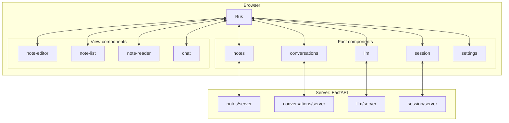
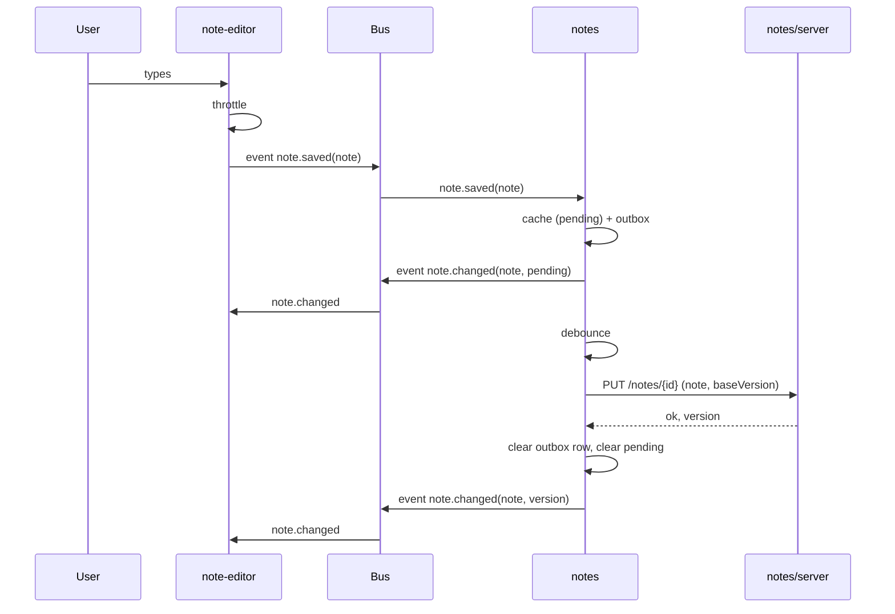
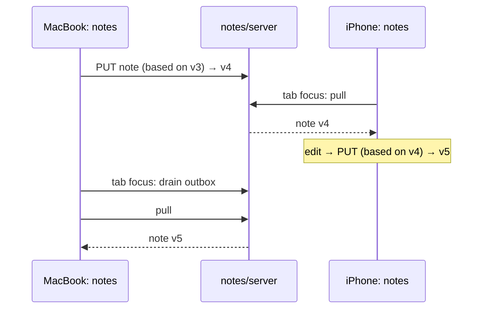
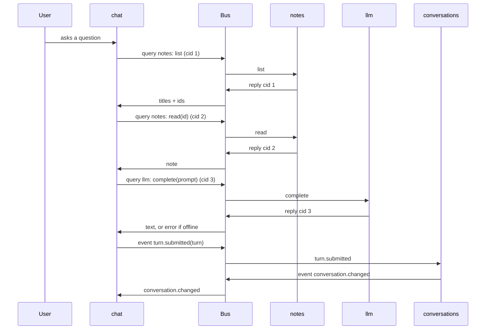

# Slip-box architecture

How this application is built, for people joining the project. It covers the idea, the building blocks, how they exchange information, the contracts between them, the pages that compose them, the libraries we lean on, and how the rules are enforced. It contains no implementation.

---

## 1. The idea

Niklas Luhmann wrote dozens of books without ever sitting down to write a book. He wrote thousands of small, finished notes, each on one idea, each pointing by name to related notes, and kept them in a slip-box. A book was a path through the box. He could work on whatever interested him that day, change his mind after any note, and the collection still grew into something coherent.

We build software the same way. A **component** is a note: small, complete, tested, useful on its own. Components never touch each other. They announce facts, give instructions, and ask questions through one shared piece of infrastructure, the **bus**, which is the slip-box. An **app** is a path through the box: a page that lists which components to load and nothing else.

The property we optimise for: anyone, including a coding agent, can add, rewrite, or delete a component without opening any other component.

---

## 2. The mapping

| Luhmann | Here |
|---|---|
| A note: one idea, finished, self-contained | A component: one concept, or one way of looking at it |
| The slip-box | The bus |
| A pointer ("see 21/3d7") | Subscribing to a named event, or addressing a named component |
| The index card at the front of a stem | A component's manifest |
| A stem: a note and its follow-ups | A stem: a fact component and its views |
| A book | An app page that declares which components to compose |
| Working on whatever is interesting today | Adding a component nobody planned for |

Where the analogy strains: a book only has to read well, an app has to run. So pointers between components are stricter than Luhmann's. They are contracts (section 7), and changing a contract is the one thing that can break a neighbour.

---

## 3. Building blocks



Every line between a component and anything else goes through the bus. The only exception is a fact component talking to *its own* server module, which is the same component on the other side of the network.

### 3.1 Two kinds of component

**A fact component owns a concept.** The notes, the conversations, the settings, the current session, access to the language model. It is headless. It is the single place the fact lives. It emits an event whenever the fact changes, and it answers queries about the fact.

Where it stores the fact is its own business, and there are three shapes:

| Shape | Storage | Offline | Example |
|---|---|---|---|
| **Local-only** | Browser only: localStorage, IndexedDB, memory | Always works; follows the device | `settings`, `trace`, `viewport` |
| **Replicated** | Browser cache + server, kept in sync (section 5) | Works; syncs later | `notes`, `conversations`, `session` |
| **Remote-only** | The fact can only be produced by the server | Fails honestly, with an error reply and, where other views need to know, an `unavailable` event | `llm`, `catalog`, `pages` |

A fact component that needs the server brings its own server module with it, in the same directory (section 11.1).

**A view component owns a way of looking at or acting on a concept.** Editing, listing, reading, chatting. It owns only its own UI state: cursor position, scroll, which tab is open, the draft in the input box. It points at one or more fact components, queries them, listens to their events, and emits events about what the user did. It never holds a copy of a fact it would be sad to lose.

### 3.2 Inside a component

Every component, of either kind, has an **actor**: its brain, a mailbox processed one message at a time, where all decisions are made. View components add a **view**, the visible part, which renders the actor's state and forwards user gestures to the actor as commands. Fact components add a **store**, their private persistence, and possibly a **server module**.

Every component also has a **browser entry**, the one file a page loads: `view.js` for a view, `fact.js` for a fact. `fact.js` creates the actor with its inputs and mounts it on the bus; `machine.js` itself starts nothing, so it can be imported anywhere.

A component's **manifest** (section 7.3) is not a separate file: it is read from the actor's definition.

### 3.3 The bus

The one shared piece of infrastructure, built once. It carries events, commands, and queries (section 4), routes each to the right mailboxes, validates every event, and every query's payload and reply, against the contract registry, refuses emits a component has not declared, and knows nothing about what any event means. It keeps nothing: there is no event log. Facts persist in fact components; the bus is only how the news travels.

The bus has one tap: a listener called synchronously with a record of every routing decision, an event or a query and its outcome. The bus still keeps nothing; the `trace` fact component keeps the session's records.

### 3.4 The server

Not special. It is the far end of the fact components that chose to have a server side. Each such component owns its own FastAPI router, mounted at `/api/<component>`, its own SQLite database, and its own migrations. The server discovers routers by walking the components directory. There is no shared sync endpoint and no shared database.

Authentication is one more fact component: `session`. Its server module runs the passkey (WebAuthn) ceremonies and sets an HttpOnly cookie; its browser actor never sees the cookie, it queries its own server module for "who am I" and emits `session.changed`. Nothing else in the system knows authentication exists.

### 3.5 Pages

A page is an HTML file the browser loads: an import map and a list of component tags, nothing else. The tags are the page's *default* composition (3.6). There are five kinds, described in section 8, and an app is one of them.

### 3.6 The composer

A page's tags are the default composition, not the final one. The **composer** is the second piece of shared infrastructure after the bus: loaded once per page, it reads which implementation the user chose for each swappable **role** (7.3) and mounts that one in place of the page's default, re-swapping when the choice changes. Besides a document fact (7.5) it is the only thing allowed to change the page after load, and it changes only role-bearing elements, in place — never `html`, `head`, or `title`.

Like any asker it queries `settings: read` for the starting picture and follows `settings.changed` after (4.3); being infrastructure rather than a component, it may import a chosen variant's `view.js` by URL to define it. A swap removes the default element — whose actor unmounts cleanly on disconnect, leaving nothing on the bus — and inserts the chosen one with the same attributes and DOM position, so the view keeps its place in the dock (12).

---

## 4. Three kinds of information

Everything goes through the bus. There is no other channel.

| | Event | Command | Query |
|---|---|---|---|
| What it is | A fact that happened | An instruction | A question |
| Tense | Past: `note.saved` | Imperative: `focus` | Interrogative: `read(id)` |
| Addressed to | Nobody; broadcast | One instance, by name | One fact component, by name |
| Reply | Never | Never | Always, routed back to the asker |
| Who may send | The fact component that owns the fact, or the view where the user acted | Anyone | Anyone, but only fact components answer |
| Persisted | No | No | No |

### 4.1 How addressing works

Every component instance has an address: its name, and an instance id when a page holds more than one (`notes`, `note-editor#1`, `note-editor#2`). A command or query names its target; the bus places it in that mailbox. An event names no target; the bus places it in every mailbox that subscribed to that event name.

### 4.2 How queries work

A query is a message carrying the target address, the query name, its payload, and a **correlation id** generated by the asker. The bus delivers it to the target's mailbox. The target's actor answers by sending a reply carrying the same correlation id; the bus routes the reply to the asker's mailbox, and the asker matches it to the question it had open. A query that reaches no fact component, or a fact component that cannot answer (offline, not found), still produces a reply, one that says so. The asker never waits on anything but its own mailbox.

In the browser this is `ask(machine, target, name, payload)` on the bus: it returns a promise that settles when the reply reaches the asker's mailbox, and a machine consumes it through `fromPromise`, the function arriving through `input`, so the machine stays importable in Node. A query to a target nobody mounted is replied to at once with `{ error: "no-answerer" }`; one the target does not answer with `{ error: "unknown-query" }`. A query aimed at a view, or one the asker did not declare (section 7.3), is refused.

### 4.3 The five rules

**Every fact has exactly one owner.** If two components need the notes, one of them is `notes` and the other asks it. There is no shared database in the browser and no copy that can drift.

**Only fact components answer queries.** A view queries `notes`, never `note-list`. If a view wants to know what another view is showing, that view should have emitted an event (`note.opened`) and this one should have listened.

**Events are self-contained.** `note.saved` carries the whole note, not an id that forces the consumer to ask. This costs duplication and buys isolation. Volume is not a concern: inside the browser a whole note per event is free, and the view that produces changes coalesces at source, so an editor emits `note.saved` at a short throttle while the user types and at once on blur, never per keystroke. The fact component announces each one immediately; what it debounces is the network (section 5), not the news.

**Query for the starting picture, subscribe for everything after.** A view that queries `notes: read(id)` must also listen to `note.changed`, and must treat any later event with a newer version as authoritative. Nothing may assume some other component finished reacting first.

**A fact component learns what the user did from events.** A view where the user acted emits the gesture as an event (`note.saved`, `viewport.selected`); the fact component that owns the concept consumes it. Commands address views: one instance among several, or an instruction that is not a fact (`focus`, `load(id)`).

---

## 5. Storage and sync

Fact components are **local-first**: a change is written locally and announced immediately; the server learns about it afterwards. The user never waits for the network, and the app works offline for every replicated and local-only fact.

For replicated fact components:

- The browser side keeps a cache in IndexedDB and an **outbox**: records changed locally and not yet acknowledged by the server. A row is deleted the moment the server acknowledges it. The outbox is the only thing in the browser that must not be lost.
- A record changed locally is marked *pending* until acknowledged. Views may show this.
- The fact component drains the outbox whenever it can, coalescing by record id so three offline edits become one write.
- On page load and whenever the tab regains focus, it first drains the outbox, then pulls what changed on the server. A save drains once typing has paused, without a pull, and a tab going to the background drains at once, so another device finds the latest copy. This is how work started on a MacBook continues on an iPhone and back: no live stream, no manual refresh.
- Every record carries a **version**, assigned by the server. A write states the version it was based on. The server rejects a write based on a stale version, and the fact component emits a `conflicted` event carrying both copies, so a view can show them rather than silently losing one. This is what makes it safe to leave a tab open on one device and continue on another. Simultaneous editing on two devices is not a goal.
- Ids are generated in the browser (ULIDs), and server writes are idempotent upserts, so retries and duplicates are harmless.
- A deletion is a write like any other: the record stays as a **tombstone** (a `deleted` flag), versioned and pulled like a change, so a pulling device learns the note is gone; it is never purged. A delete carries no base version and is not refused for a stale one — a delete always wins, and an edit that reaches the server after a delete comes back as a conflict rather than reviving the note. The fact keeps the tombstone's title and body, so what was deleted can still be shown or restored later.

On the server, each replicated fact component has **one SQLite file per user**: `data/<user>/<component>.db`. The session resolves the user, the component's router resolves the file, and neither the schema nor the browser ever mentions users. The backend is written as if for a single user. Litestream streams every file continuously to object storage; the architecture never sees it, and restoring is one command.

`session` is the exception: it keeps one shared file `data/session.db`, the identity registry, because it defines users and so cannot be per-user. While no user is signed in a replicated fact's outbox does not drain; signing in starts draining, so what was written anonymously becomes the account's, and what was not acknowledged before sign-out uploads at the next sign-in.

While anonymous, `notes` mints versions in the browser and the server adopts the client's number on first upload, so the anonymous note carries its history into the account. Registration is capped by `MAX_USERS`; once the registry is full `session` reports `registrationOpen` false and refuses a new passkey with `registration-closed`. `session`'s own replicated shape is not an outbox but a localStorage cache plus an owed sign-out, because identity has no records to version: there is nothing to base a write on, only the single fact of who is signed in.

---

## 6. Interactions

Every diagram below routes through the bus, because that is the only way anything travels.

### 6.1 Writing a note (local-first)



The editor is finished the moment it emits. Every other view interested in notes learns of the change the same way, from `note.changed`, whether it came from this tab, from the server, or from another device.

### 6.2 Continuing on another device



If the MacBook still had an unsent edit based on v4 when it regained focus, the server rejects it and `notes` emits `note.conflicted` with both bodies.

### 6.3 A view querying facts: chat about my notes



`chat` holds only the draft in the input box. The transcript is owned by `conversations`, model access by `llm`, the notes by `notes`. Each can be replaced without touching `chat`.

### 6.4 Adding components nobody planned for

Suppose the build order is: `notes` + `note-editor`, then `note-list`, then `split-view`, then `chat`, then `note-reader`.

- `note-list` queries `notes: list` on start, subscribes to `note.changed` and `note.deleted`, emits `note.selected` and, when a note's undo window runs out, `note.discarded`. Nothing existing changes.
- `split-view` is nearly pure declaration: two slots, and a `follows` attribute that turns `note.selected` into a `load(id)` command on the chosen slot.
- `chat` queries `notes` and `llm`, emits `turn.submitted`, which `conversations` consumes. Nothing existing changes.
- `note-reader` subscribes to `note.selected`, queries `notes: read(id)`. Nothing existing changes.

Each later component used only contracts that already existed, and the components page (section 8) showed which ones were available before it was built. This is the Zettelkasten property made concrete: a new note points at old notes; old notes do not change.

A page may declare a view's home side with a `side="left|right|bottom"` attribute on a `dock-desk` child, read like the `label` convention (neither is a `dock-desk` tag attribute). `dock-desk` seeds the initial layout from the declared sides only when the `dock` fact has no stored arrangement; the first user gesture stores a layout, and that stored layout wins thereafter. The layout fact stays owned by `dock` — `dock-desk` only chooses a starting picture when the fact has none.

---

## 7. Contracts

Contracts are the only coupling in the system. Every contract is **declared once, in the component that owns it, and derived everywhere else**. Nothing is hand-copied onto a page, and section 11 makes a stale declaration fail at runtime rather than drift.

### 7.1 Event vocabulary

Every event has a name, an owner, and a JSON Schema for its payload, kept in the owning component's directory. Names are `subject.pastTenseVerb`. The set of all event schemas is one of the three shared vocabularies of the system (the others are the design tokens and the icons), and it is kept small on purpose.

```
note.saved            owner: note-editor    { id, title, body, baseVersion }
note.changed          owner: notes          { id, title, subtitle, body, version, pending, updatedAt }
note.deleted          owner: notes          { id }
note.conflicted       owner: notes          { id, mine, theirs }
note.selected         owner: note-list      { id }
note.discarded        owner: note-list      { id }
note.opened           owner: note-editor    { id }
conversation.changed  owner: conversations  { id, turns, version }
dock.arranged         owner: dock-desk      { stage, docks }
dock.changed          owner: dock           { stage, docks }
layout.switched       owner: layout-switch  { arranging }
settings.changed      owner: settings       { nav, viewportSwitchHidden, layoutSwitchHidden, arranging, editors }
settings.edited       owner: settings-sheet { nav, viewportSwitchHidden, layoutSwitchHidden, arranging, editors }
llm.unavailable       owner: llm            { reason }
session.changed       owner: session        { userId | null, registrationOpen }
session.refused       owner: session        { reason }  reason ∈ cancelled | registration-closed | unknown-credential | unavailable
signin.requested      owner: session-switch  {}
signout.requested     owner: session-switch  {}
trace.recorded        owner: trace          { seq, at, tab, kind, name, from, to, ignored, outcome, reason, cid, payload, states }
turn.submitted        owner: chat           { conversationId, turn }
viewport.selected     owner: viewport-switch { viewport }
viewport.changed      owner: viewport       { viewport }
```

Payload shapes are only ever **extended**: never a removed field, a renamed field, or a new required field. If a change cannot be additive, it is a new event with a new name.

Because the vocabulary is shared, it is not grown casually: **adding an event, or changing an event schema, needs explicit permission from the user first**, even when the change is additive. The proposal names the event, its owner, its payload, and the component that needs it; nothing is written until it is approved. The same holds for the design tokens (section 7.4).

### 7.2 Command and query contracts

Every command a component accepts, and every query a fact component answers, is named, with the shape of its payload and, for queries, the shape of the reply.

```
note-editor#n: focus
note-editor#n: load(id)
notes: list              → { notes: [{ id, title, subtitle, updatedAt }] }
notes: read(id)          → { note } | { error: "not-found" }
llm: complete({ prompt, context }) → { text } | { error: "unavailable" }
catalog: list            → { components: [{ name, status, kind, shape, owns, attributes, emits, consumes, accepts, answers, asks, interacts }] } | { error: "unavailable" }
pages: list              → { pages: [{ path, title, kind }] } | { error: "unavailable" }
catalog: contracts       → { events: [{ name, owner, schema, consumers }], queries: [{ target, name, payload, reply, askers }], commands: [{ target, name, payload }] } | { error: "unavailable" }
trace: list              → { records: [record] }
viewport: read           → { viewport }
dock: read               → { stage, docks: { left|right|bottom: { open, views, active } } }
settings: read           → { nav: [{ path, hidden }], viewportSwitchHidden, layoutSwitchHidden, arranging, editors }
session: read            → { userId: string | null, registrationOpen: boolean }
```

What a machine handles is read from the keys of its `on` handlers, in any state, by one convention: a dotted name (`note.changed`) is a consumed event; a name ending in `?` (`list?`) answers the query of that name; a leading underscore (`_mediaChanged`) is an internal message the bus never routes; anything else is an accepted command. A query is delivered to the answerer as `{ type: "list?", cid, payload, reply }`, and the answerer calls `reply(value)` exactly once.

A query's payload and reply shapes are JSON Schemas in the answerer's `queries/<name>.json`, as `{ payload, reply }`; a command's payload shape is in the acceptor's `commands/<name>.json`. The bus validates a query's payload on delivery and its reply before it reaches the asker, so a query schema cannot go stale, the same as an event's.

### 7.3 Manifest

A component's manifest is not written by hand. It is read from the actor's definition:

- **consumes**, **accepts**, **answers**: derived from what the actor's machine handles.
- **emits** and **asks**: the two things that cannot be discovered by inspection, so they are declared as metadata on the machine itself, next to the handlers. `emits` lists event names; `asks` lists `"target: query"` strings. The bus refuses any emit or ask not on its list, so the declarations cannot go stale without the code failing.
- **kind**, **shape**, **attributes**, and **owns**: metadata on the same machine. **shape** (section 3.1's storage shapes) and **owns**, a short lowercase noun phrase naming the fact, belong to fact components only; **attributes**, the ones the tag understands, to view components only.
- **role** (view components, optional): a lowercase name for a slot of interchangeable implementations — `note-editor` and `note-editor-cm6` (a CodeMirror 6 rich editor with Vim) both declare `role: "note-editor"`. Members of a role share a contract (same emits, asks, accepts, answers), so one stands in for another; the composer (3.6) uses the role to know which are alternatives, and a page's tag for a role is its default.
- **status** is not declared. A component is *built* when its browser entry exists (`view.js` or `fact.js`), *planned* when it has only `machine.js` and `events/`.

From manifests alone the system computes, for every component, the components it interacts with: for each consumed event, who emits it; for each emitted event, who consumes it; for each query, who answers it.

Manifests reach the browser through one fact component, `catalog`: remote-only, owning every component's manifest. Its server module walks `components/` and runs the manifest reader, `checks/manifests.mjs` under `checks/register.mjs`, which is infrastructure like the bus, so the check and the page read the same thing; the interactions are computed there too.

### 7.4 Design tokens

The visual vocabulary: a small set of CSS custom properties for colour, spacing, type, radius, motion. Views use tokens and nothing else: every colour, every length that places or sizes a box, every type value is a token or a `calc()` of tokens. Tokens are the second shared vocabulary and are kept minimal: a token exists because a view uses it, and a token nothing uses is removed. Every change to `tokens.css` needs explicit permission from the user first.

The document layer is three files: `tokens.css`, the custom properties; `base.css`, the `@font-face` declaration, the inherited properties set on `html` and `body`, and the rules by which the document reacts to a document fact (7.5); and `icons.js`, the icons (7.6). There are no shared utility classes, because shadow DOM stops a class selector at the component boundary; only inherited properties and custom properties cross it, which is why tokens can theme a view and a `.btn` class could not.

### 7.5 Document facts

A few facts are properties of the document itself rather than of any view: which colour scheme the page is in, and later perhaps its language or direction. A fact component that owns such a fact writes it as exactly one attribute on `html`, `data-<its name>`, and touches nothing else in the DOM. Views only ever read the document. The list is closed: adding a row, or changing what a row writes, needs explicit permission from the user first, the same as an event or a token.

| Component | Writes |
|---|---|
| `color-scheme` | `data-color-scheme` |
| `viewport` | `data-viewport` |

### 7.6 Icons

The glyphs views may use: the third shared vocabulary, beside the events (7.1) and the tokens (7.4). They are Phosphor Icons, regular weight, copied one icon at a time, path data only, into `tokens/icons.js`, and reached as `icon(name)` from the bare specifier `icons`. An icon is sized `1em` and filled `currentColor`, so it matches the text it sits in and follows the scheme. The set is closed: an unknown name throws. An icon exists because a view uses it, and one nothing uses is removed. Adding one needs explicit permission from the user first: the proposal names the Phosphor name and links `https://phosphoricons.com/?q=<name>`, so the glyph is seen before it is approved. The tokens page shows every icon. Running text keeps typographic arrows: a `→` in a table header is prose, not an icon.

---

## 8. Pages

A page is an HTML file: an import map plus component tags with attributes. Nothing else. Precisely, a page may contain only: the `<!doctype html>` declaration; `html`, `head` and `body`; `meta` and `title`; `link[rel=stylesheet]` whose `href` is under `/static/tokens/`; one `script[type=importmap]` whose JSON equals `vendor/vendor.json`'s importmap; `script[type=module][src]` whose `src` is a built component's browser entry, `view.js` or `fact.js`, under `/static/components/`, or the composer under `/static/composer/`, with no inline body; and custom-element tags (a hyphen in the tag name) with any attributes. Anything else — a `div`, a class, inline logic — fails the page check (section 11.2). The tags are the page's default composition; where a tag fills a role (7.3) and the page loads the composer, the composer (3.6) may mount a different implementation the user chose, in place, and a role's default tag needs only its own `view.js` loaded — the composer imports other members on demand. Five kinds, in increasing order of composition:

1. **Tokens page.** Shows the design tokens and the icons, so the visual vocabulary can be reviewed before anything uses it.
2. **Contracts page.** The event, command, and query vocabulary, drawn from the running components: each contract with its schema, who emits or answers it, who consumes or asks. This is where the shared language is reviewed.
3. **Components page.** Every component, built or planned, drawn from its manifest: kind, shape, what it emits and consumes, what it answers, what it owns, and the computed list of components it interacts with. This is where you stand in front of the slip-box and think about which notes could point at which. The components page is the stem page of `catalog`.
4. **Stem pages.** One per root component with its related components wired together: a fact component with its views (`notes` with editor, list, and reader; `conversations` with chat; `dock` with `dock-desk`; `settings` with `settings-sheet`), or a container view with the views it composes (`work-desk` with the tokens, contracts and components views). The `trace` stem page (`trace` with `trace-list`) shows the traffic actually observed on the bus this session. A stem page is the test bed for its root.
5. **App pages.** Things created so far composed around a purpose: a journal, a chat with the language model, a book reader, or combinations of these. An app page is a book: a path through the box.

Pages are listed by the `pages` fact component, and `page-nav` is how a page links to the others. A page declares its kind with `<meta name="kind" content="…">`, one of `tokens`, `contracts`, `components`, `stem`, `app`; `pages: list` returns pages in that order, then by path.

The contracts page and the components page show the same data in two arrangements. Neither is hand-written, so they cannot diverge.

---

## 9. How a component comes to exist

Because changing a contract is the expensive operation, contracts are decided before code.

1. Create the component's directory with a machine that declares only metadata, `status: planned`, and any new event or query schemas.
2. It appears on the components page and the contracts page. Review it there against its neighbours: does it consume events nobody emits, ask queries nobody answers, duplicate a fact someone already owns, or need a change to an existing contract?
3. Only when the contracts settle, write the actor, then the store or view, then the server module if any, then tests.
4. Add its browser entry and put it on a page: the entry is what makes it built.

Coding agents follow the same four steps. Step 2 is the human's, and the components page is where it happens.

---

## 10. Libraries

Each block maps to one small, mature library, vendored under `/vendor` and loaded through an import map. No build step: every change, browser or server, is visible on reload. Beside each library is what we lean on and what we do not, so that the intended use is unambiguous.

| Block | Library | Licence | We use | We do not use |
|---|---|---|---|---|
| View | Lit | BSD-3 | Templating (`html`); reactive properties, which turn tag attributes such as `name` and `follows` into state the view reacts to, which is what lets pages be pure declarations; shadow DOM, which isolates a view's styles so it can only be themed through tokens, the one thing that crosses a shadow boundary; the connected/disconnected lifecycle, where a view subscribes to and unsubscribes from the bus, so a removed tag leaves nothing behind; reactive controllers, as the home for "attach this actor's state to this view" | Decorators (need a build); Lit context or any cross-component sharing (that is the bus's job) |
| Rich editor | CodeMirror 6 + @replit/codemirror-vim | MIT | `EditorView`, a `StateField` and line decorations for `note-editor-cm6`: a three-level (Title/Heading/Subheading) buffer whose markers live only in the wire string, never in the marker-free document Vim edits; Vim normal mode; the theme keyed to tokens; mounted into the shadow root with the `root` option so style-mod stays off the document | A markdown/@lezer grammar (levels are our own field, not parsed syntax); line numbers, the search panel, autocompletion |
| Actor | XState v5 | MIT | Machines as the actor definition, which is also where the manifest is read from; the actor system for mailboxes, one message at a time, and addressing by id; `fromPromise` for a fact component's calls to its own server module; the `inspect` hook for tracing | Spawning actors that talk to other components' actors directly; anything that bypasses the bus |
| Store (browser) | Dexie | Apache-2 | Tables and transactions, one database per fact component | Live queries (the bus is the reactivity); a shared database |
| Bus | native `EventTarget` | — | Delivery; everything else (routing, validation, correlation) is ours and small | — |
| Ids | ULID | MIT | Client-generated, sortable ids | Server-assigned ids |
| Server | FastAPI | MIT | One router per fact component, discovered by walking the components directory; `--reload` | A shared data layer |
| Store (server) | SQLite | public domain | One file per user per fact component | A shared schema |
| Backup | Litestream | Apache-2 | Continuous replication of every file | — |
| Schema (browser) | @cfworker/json-schema | MIT | Validating payloads in the browser against draft 2020-12, the validator constructed with the draft given explicitly, behind our `validate()` wrapper | A draft chosen implicitly |
| Schema (server) | Python `jsonschema` | MIT | Validating payloads server-side, and the schema compatibility check (section 11.2) when it arrives | — |
| Font | Inter | OFL-1.1 | One self-hosted variable file, all weights | Italic, until a view needs it |
| Icons | Phosphor Icons | MIT | Regular-weight path data, one icon at a time, copied verbatim from `@phosphor-icons/core` 2.1.1 `assets/regular/<name>.svg` (7.6) | The font, the web and react packages, other weights, the whole set |
| WebAuthn | py_webauthn | BSD-3 | The passkey ceremonies (registration and authentication options, and verifying the browser's response) in `session`'s server module | Cookies or sessions, which are `server/user.py`'s HMAC over the user id |
| Tests | Node's `node --test` and Playwright (WebKit, then Chromium) | MIT / Apache-2 | Browser tests per component under `tests/`; Node tests for the bus under `bus/tests/`; not vendored, Playwright is located through `PLAYWRIGHT_MODULE` in the gitignored `.env`. Actors can also be imported in Node through `checks/register.mjs`, which resolves the import map the way the browser does. A WebAuthn ceremony is tested in Chromium only, through its virtual authenticator; WebKit covers the rendering | A test framework |

Libraries are vendored as their official builds at pinned versions, copied verbatim with their licence and source map, and recorded in `vendor/vendor.json` with their source URLs, licences, and a sha256 per file. The vendor check (section 11.2) fails on any file that is unlisted, missing, altered, or whose source-map reference does not resolve.

Two pieces are wrapped behind our own small interfaces, because their surface is small and swapping is plausible: the **store** (Dexie now, could be SQLite in the browser) and the **bus** (`EventTarget` now, could be a worker). XState and Lit are not wrapped: they are the actor and view semantics, and a wrapper would be a thinner XState.

**Tracing.** The bus taps every routing decision (section 3.3): who emitted or asked what, who received it, who ignored it because their state does not handle it, what was dropped for lack of a subscriber, refused for lack of a declaration, or never answered. The `trace` fact component keeps those records in memory since the page loaded, bridges tabs of the same origin over a `BroadcastChannel` so an inspector tab sees what an acting tab did, and prints one line per record to the console at debug level, so a person or an agent reading the console through Playwright has a complete, ordered transcript. `trace-list` shows the same record on the `trace` stem page. This is the primary debugging tool and it is meant to be used autonomously.

Deliberately not used: a global state store, a micro-frontend framework, a message broker, a bundler, any framework that wants to own the page.

---

## 11. Enforcement

The system is maintained by coding agents, so the rules are not advice. Every violation fails immediately, and one `check` command is the definition of done: a bare `check.py`, every static rule plus every test, is what must pass before a task ends.

The check has two phases: the fast phase (every static rule) runs after every edit, and the full run (fast phase plus all tests) is the task-end gate. While iterating, the full run may be narrowed for faster feedback: `check.py --changed` (paths derived from `git` against `HEAD`) or `--only <components>` runs the fast phase plus just the tests reachable from the changed components — their one-hop bus-interaction partners and the components that share a page with them — while any infrastructure change (`bus`, `store`, `checks`, `vendor`, `tokens`, the `server` entry, `.env`, or `requirements.txt`) still runs everything. These narrowed modes speed the edit loop and back the Stop hook, but they are not the definition of done: the bare full run is. Each phase has a time budget that does not grow with the system: the fast phase within one second in total, and every test within five seconds on its own. Exceeding a budget is itself a failure, naming the slowest rules or the slow test, so the fast phase stays fast enough to run constantly and a slow test is found by name rather than hidden in a total.

### 11.1 Directory per component, front and back

```
components/
  notes/
    machine.js        actor definition; manifest is read from here
    store.js          IndexedDB cache + outbox, behind the store interface
    fact.js           browser entry: creates the actor with its inputs and mounts it on the bus
    events/           JSON Schema per event this component owns
    queries/          JSON Schema per query this component answers: { payload, reply }
    server/
      router.py       FastAPI router for /api/notes
      schema.sql      per-user SQLite schema and migrations
    tests/
  note-editor/
    machine.js
    view.js
    commands/         JSON Schema per command this component accepts
    tests/
  settings/
    machine.js
    store.js          localStorage, behind the store interface
    fact.js
```

The components tree sits inside a small repository-wide layout:

```
server/          FastAPI entry (named "server", not "app", so it never clashes with pages/apps/)
  user.py        the entry's user infrastructure: who the request is from and where their files live (UNBLENT_DATA overriding data/); a server module may import it
  tests/         HTTP tests for the entry; infrastructure like the bus, not a component. Never served
components/      one directory per component, as above
vendor/          vendored libraries and vendor.json (the manifest and the import map)
tokens/          tokens.css, base.css and icons.js, the document layer (7.4, 7.6)
pages/           the HTML pages (section 8), e.g. pages/design/tokens.html
checks/          check.py, the one check command
bus/             the bus (built once)
composer/        the composer (3.6), loaded once per page; tests/ never served
store/           the store interface; tests/ never served
deploy/          systemd unit, litestream.yml (section 5) and anything else the host needs; never served
data/            per-user SQLite files (section 5), gitignored
.env             machine-specific settings and secrets (SESSION_SECRET, RP_ID, MAX_USERS), gitignored
```

Static serving is namespaced so the future app can own `/`:

| URL | Serves |
|---|---|
| `/static/vendor/…`, `/static/components/…`, `/static/tokens/…` | those directories, `Cache-Control: no-cache` |
| `/static/bus/…` | the bus, `Cache-Control: no-cache`; its `tests/` are never served |
| `/static/composer/…` | the composer, `Cache-Control: no-cache`; its `tests/` are never served |
| `/static/store/…` | the store interface, `Cache-Control: no-cache`; its `tests/` are never served |
| `/design/<name>` | `pages/design/<name>.html`, 404 if missing |
| `/apps/<name>` | `pages/apps/<name>.html`, 404 if missing |
| `/api/<component>/…` | that component's router (discovered by the walk) |
| `/` | the app; for now a redirect to `/design/tokens` |

A component's `server/` (its Python server module) and `tests/` are never served: the static mount for `components/` 404s any path that dips into them, so source and tests never reach the browser.

Deleting a component is deleting one directory and its databases. Nothing else needs to change, and if it does, the checks say which contract was broken.

### 11.2 The checks

| Rule | Enforced by |
|---|---|
| Components never touch each other | Import check, JavaScript and Python: every import specifier is either a relative path that stays inside the component's own directory (no `..`), or a bare specifier the page's import map resolves — a vendored name from `vendor/vendor.json`, or `bus`, `store`, or `icons`. A server module may import the standard library, the packages named in `requirements.txt`, `server.user` (the entry's user infrastructure), or a relative module inside its own `server/`. The composer, like the bus, is infrastructure outside `components/`: a page may load it, and it may import a role member's `view.js` by its `/static/components/…/view.js` URL |
| Everything goes through the bus | Same check; there is no other importable channel |
| Events match their contract | The bus validates every emitted event against the schema registry at runtime and throws on unknown names or invalid payloads |
| Queries match their contract | The bus registers each answered query's schema at mount and validates payload and reply at runtime |
| Contracts are written down | Contract check: every declared emit has `events/<name>.json`, every answered query `queries/<name>.json`, every accepted command `commands/<name>.json`; each parses as JSON Schema with the draft stated; no schema file without its declaration or handler |
| Only declared events are emitted | The bus refuses an emit whose name is not in the emitter's declared list |
| Only fact components answer queries | The bus refuses to route a query to a view component |
| Contracts only grow | Schema compatibility check against the previous commit: fails on removed, renamed, or new required fields; prints the affected components from the manifests |
| One owner per fact | Store check: a fact component may open only the database bearing its own name; view components open none |
| Pages contain no logic | Page check: only an import map and tags, and exactly one `meta[name=kind]` naming one of the five kinds of section 8 |
| Tokens only | Style check: views use no colour, spacing, size, or type value that is not a token, in both `css` templates and the inline `style` attributes of `html` templates. Size means any property that places or sizes a box: width, height, inset, grid tracks, border width. Percentages, `fr`, and unitless factors in `calc()` are relative and allowed |
| Icons are used and known | Icon check: every name in `tokens/icons.js` is used by some view as a literal `icon("name")`, and every `icon("name")` in a view exists. Names are literals in views, so the check stays static |
| Vendored code is what it claims | Vendor check: every file under `vendor/` is listed in `vendor.json` with a matching sha256, every listed file exists, and every `sourceMappingURL` resolves |
| Nothing fails in the browser | Browser tests fail on any console error, page error, failed request, or 4xx/5xx response while a page loads |
| A test owns its browser | Browser rule: the check preloads a hook that fails any test leaving a browser it launched open when it ends, closes that browser at once, and fails the run if a suite leaves one open, so a timed-out test cannot leak a browser into the next and exhaust the host |
| Manifests cannot be stale | There is nothing to keep in sync: they are read from the machine, and undeclared emits fail at runtime |
| Manifests are well-formed | Manifest check: every machine imports in Node, its id equals its directory name, `kind` and `emits` are present and valid, `shape` and `owns` are present on fact components only, `attributes` on view components only, and `status` is absent because it is derived |
| A component is one directory of known shape | Component check: `machine.js` present, no entries beyond `machine.js`, `view.js`, `fact.js`, `store.js`, `events/`, `queries/`, `commands/`, `server/`, `tests/`; a view has no `fact.js`, store, server or `queries/`, a fact has no `view.js`; `view.js` defines the element named after its directory; a component with a browser entry has tests |
| Pages compose only what exists | Page check: every custom element on a page is a built view whose `view.js` the page loads, every loaded `view.js` is used, and every loaded `fact.js` belongs to a fact component; the composer script is allowed, and a role's default tag needs only its own `view.js` loaded |
| Roles are coherent | Role check: every component declaring a role exposes the same contract (emits, asks, accepts, answers), so a swap cannot surprise a neighbour |
| The composer stays in its lane | Composer check: the composer changes only role-bearing elements, in place, and never `html`, `head`, or `title` |
| Only document facts write to the document | Document check: no file under `components/` writes to `document` (its root element, `body`, `head`, or `title`) except the `fact.js` of a component listed in section 7.5, and that one writes only its own `data-<name>` attribute |
| The layout is what the document says | Layout check: every top-level directory appears in the listing in 11.1 |
| The check stays fast | Time budget: the fast phase within one second in total, every test within five seconds on its own; exceeding either fails and names the slowest rules or the slow test |

The architecture document describes the rules; the checks are what make them real.

---

## 12. Constraints and known edges

- **No query between views.** If two views seem to need to talk, either one should emit an event the other listens to, or they are one view.
- **Ordering across components.** The bus delivers in order within a tab, but two components reacting to the same event finish in any order. Example: `note-reader` reacts to `note.selected` by querying `notes: read(id)` while the editor's throttled `note.saved` for the same note is still in flight; the reader gets the old body. Protection is the fourth rule of section 4: it also listens to `note.changed` and adopts the newer version.
- **Remote-only facts fail offline.** That is by design: `llm` answers with an error and emits `llm.unavailable`; a view decides what to show.
- **Three shared vocabularies.** The event registry, the design tokens and the icons are global schemas in disguise. All are kept small: events are additive-only, tokens are minimal, icons grow one glyph at a time, each approved by sight. All change only with permission, and all are reviewed on a page before use.
- **No cross-user features.** One database per user per component means the server never sees two users at once. For this app that is a feature.

- **One user per browser.** Signing in adopts everything cached anonymously in that browser, so `notes` enqueues its whole cache to the account; a second account on the same browser is not a goal.

- **No surface for a refused gesture yet.** `session.refused`, `note.conflicted` and `llm.unavailable` reach no view a user sees; a future `notice-stack` view would consume them and show dismissable notices. Until then the trace is where they show.

- **Tracing crosses tabs, not devices.** The trace bridges same-origin tabs in one browser; another device has its own.

- **Swapping composition.** The composer (3.6) changes which implementation fills a role, in place; the replaced actor unmounts cleanly. A swappable view keeps its dock slot because the dock layout identifies it by its role, not its tag — the one place `dock`/`dock-desk` must key on role. Whether that touches the `dock.changed` schema or stays internal is settled when the composer is built (§9 step 2).

---

## 13. Vocabulary

- **Component**: one directory, one name, one concept or one way of looking at it; the unit of ownership. Front and back end together.
- **Fact component**: headless owner of a concept; emits when it changes, answers queries about it. Local-only, replicated, or remote-only.
- **View component**: a way of looking at or acting on a concept; owns only UI state.
- **Actor**: the deciding part of a component; a mailbox processed one message at a time.
- **View**: the visible, decision-free part of a view component.
- **Store**: a fact component's private persistence, wherever it lives.
- **Server module**: the server side of a fact component, in the same directory.
- **Outbox**: local changes not yet acknowledged by the server.
- **Bus**: the shared infrastructure that routes events, commands, and queries, and validates them.
- **Composer**: the shared infrastructure that mounts the user's chosen implementation for each role in place of the page's default, and re-swaps when the choice changes.
- **Role**: a name for a slot of interchangeable view implementations sharing a contract; the composer mounts the chosen one.
- **Event**: a broadcast fact, past tense, not persisted.
- **Command**: an addressed instruction; no reply.
- **Query**: an addressed question to a fact component; always a reply, matched by correlation id.
- **Manifest**: what a component emits, consumes, accepts, answers, and owns; read from its machine.
- **Stem**: a fact component together with its related views.
- **Page**: an HTML file, an import map and tags; tokens, contracts, components, stem, or app.
- **App**: the page kind that composes components around a purpose.
